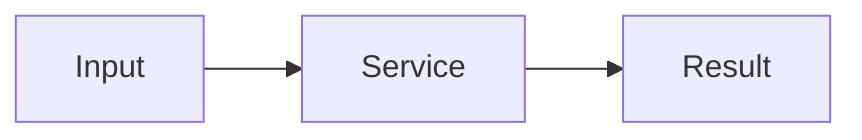

## What was stuck

Describe the client context, the current state and why the problem had not moved forward.

## Constraints

List the user, operating, technical, data, regulatory and timeline constraints that shaped the work.

## What we decided

Explain the important product and technical decisions. Include the alternatives considered when they help a technical reader understand the trade-off.

## The system

Describe the product, important workflows, architecture and technical boundaries. Use screenshots, diagrams and code where they provide evidence.

## How we validated it

Document the acceptance criteria, tests, evaluations, user checks and production observations used to decide that the system was ready.

## What went into production

State what was actually deployed or handed over. Separate shipped work from experiments and planned work.

## What changed

Report approved outcomes. Label any figures that still require client confirmation.

## Handover and limitations

Explain what the client received, what remains outside the system and any known operational limitations.

<aside class="callout">
  <strong>Publication note</strong>
  <p>Add validation evidence, delivery dates, operational metrics and handover details only after client approval.</p>
</aside>

## Authoring reference

### Supported Markdown

- Headings, paragraphs, lists, links, images, and blockquotes
- Tables, task lists, and strikethrough through GitHub Flavoured Markdown
- Syntax-highlighted fenced code blocks
- Mermaid diagrams using a `mermaid` fenced code block
- Callouts using `<aside class="callout">...</aside>`
- Toggles using `<details><summary>Title</summary>...</details>`
- Local video using `<video controls src="/case-studies/example.mp4"></video>`
- Local audio using `<audio controls src="/case-studies/example.mp3"></audio>`
- Trusted embeds using an `<iframe>` with a title and HTTPS source

Store local media under `public/case-studies/` and reference it from `/case-studies/filename.ext`.



```ts
export const example = "Syntax-highlighted code";
```

<aside class="callout">
  <strong>Callout title</strong>
  <p>Use callouts for constraints, decisions, or publication notes.</p>
</aside>

<details>
  <summary>Expandable section</summary>

  Add supporting detail here.
</details>
