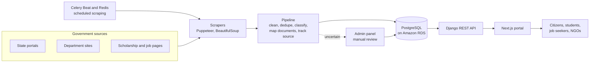
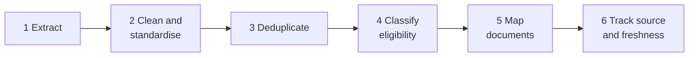
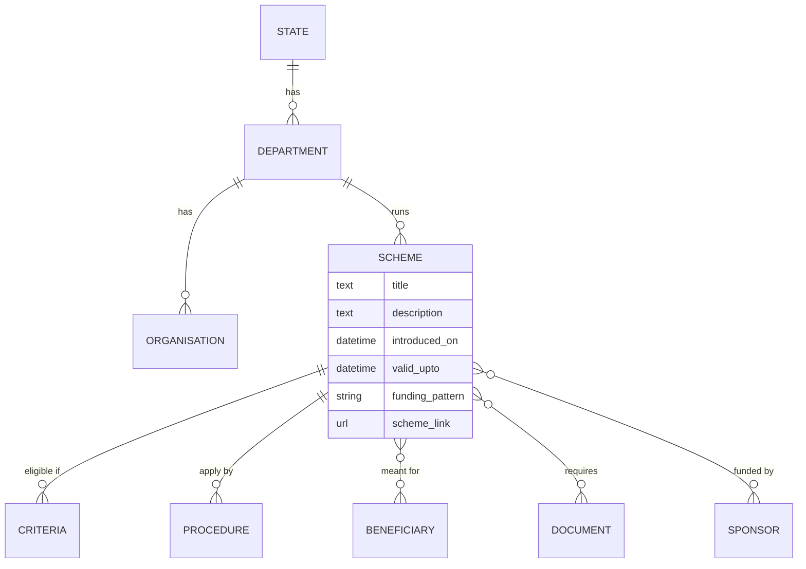
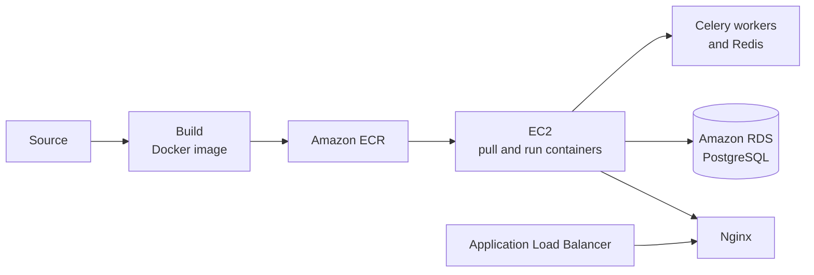

<aside class="callout">
  <strong>At a glance</strong>
  <p><b>Partners:</b> IIT Roorkee and the Social Studies Foundation, an ICSSR-recognised non-profit that supports underserved communities. <b>What we built:</b> the Community Empowerment Portal, which collects government schemes, scholarships and job openings, structures them, and shows each citizen what they may be eligible for. <b>Team:</b> six engineers led by a NewtonSchool Studio technical owner. <b>Delivery:</b> two versions, then a full handover to IIT Roorkee's own servers and GitHub organisation.</p>
</aside>

## Summary

India has thousands of welfare schemes, scholarships and job programs across central, state and departmental governments. For the communities they are meant for, the problem is often not that support does not exist. It is that nobody can find it, or tell whether it applies to them.

With IIT Roorkee and the Social Studies Foundation, we built the Community Empowerment Portal. It scrapes scheme information from government websites, turns inconsistent pages into structured records, and lets a citizen fill in a profile once to see the schemes, scholarships and jobs they may qualify for, with the documents they need and a link to the official source.

The interesting engineering problem is not scraping. It is turning messy public data into something reliable enough to make an eligibility decision on. This document explains how we approached that, what we built in each version, what is still incomplete, and how the system was handed over.

## The people it serves

The portal was built mainly for members of Scheduled Caste communities, and for other underserved groups:

- **Citizens** looking for financial aid, welfare support or opportunities they are entitled to.
- **Students** looking for scholarships.
- **Job seekers** looking for government openings.
- **Social workers and community organisations** who help others find and apply for support, and need one reliable place to look.

The goal, in the partners' words, was to bridge the information gap and promote equal opportunities for education, financial aid and employment.

## The problem, in plain language

Imagine trying to find a scholarship you qualify for. The information might be on a central ministry site, a state department site, a district portal or a PDF circular. Each site is organised differently. Some list eligibility as clear criteria. Most bury it in paragraphs. The same scheme appears on several sites with slightly different details. Some pages are out of date. Very few tell you plainly which documents to bring.

A person with time, internet access and confidence might piece it together. The people these schemes are meant for often have the least of all three.

So the portal had to do three things:

1. **Collect** scheme, scholarship and job information from many government sources, automatically and repeatedly.
2. **Structure** it, so that eligibility, benefits, procedures and documents become fields a computer can filter on.
3. **Match** it to a person, so a citizen sees what applies to them rather than everything that exists.

## Why this is hard

Collecting the data is the easy part. Making it reliable enough to act on is the real work.

| Difficulty | What it means in practice |
| --- | --- |
| Every state publishes differently | Each portal has its own layout, URLs, pagination and HTML. Scrapers break when a site changes |
| Duplicates | The same scheme appears on several portals with slightly different wording |
| Conflicting information | Deadlines, eligibility rules or required documents differ between sources |
| Eligibility written as prose | Income limits, categories, occupation, age and education requirements sit inside paragraphs, not fields |
| Missing fields | Many schemes do not state income, category, geography, occupation or documents at all |
| Freshness | Schemes change, close and reopen, so data goes stale quickly |
| Many conditions at once | Eligibility can depend on state, income, category, gender, occupation, age, education and documents together |
| Trust | Automated extraction cannot guarantee accuracy, so some records need a person to check them |

## Key decisions

### Decision 1: a canonical schema first, scrapers second

Every source is different, so we did not let any source define the data. We designed one canonical schema that reflects how government actually organises schemes, and wrote every scraper to fill that schema. Adding a new state means writing a new extractor, not redesigning the database.

### Decision 2: a relational model built for eligibility

A keyword search would have been quicker to build and much less useful. Instead, we built the PostgreSQL model so that beneficiaries, criteria, documents, sponsors and benefits are separate entities linked to each scheme. That is what lets the portal answer "which schemes apply to a scheduled-caste undergraduate in Meghalaya" rather than "which pages mention scholarships".

### Decision 3: AI for structure, people for doubt

Turning paragraphs of eligibility text into fields is a good job for a language model. Deciding whether a record is right is not. AI-assisted structuring converts free text into structured fields, and records the system is unsure about go to manual review in an admin panel instead of straight to citizens.

### Decision 4: let feedback reshape the filters

The first filters followed our assumption: type, eligibility and deadlines. Feedback from IIT Roorkee showed that people navigate by who runs a scheme and who it is for. The filters were rebuilt around central or state, department and beneficiary group, and later regrouped under plain, generic names because official department names meant little to users.

### Decision 5: build for handover from the start

The portal was always going to be run by IIT Roorkee, not by us. We used widely known tools, Django, Next.js, PostgreSQL and Docker, documented the system as we went, and planned the move to IIT Roorkee's own infrastructure as part of the project, not as an afterthought.

## The system

### Architecture



- **Scrapers.** Puppeteer drives a headless browser for dynamic sites. BeautifulSoup parses static HTML.
- **Pipeline.** Each record moves through six stages, described below.
- **Database.** PostgreSQL on Amazon RDS holds the canonical schema.
- **API.** Django and Django REST Framework expose the data to the frontend.
- **Portal.** Next.js renders pages on the server, which keeps them fast and visible to search engines.
- **Scheduling.** Celery Beat with Redis as the message broker runs scraping on a schedule. The first run loads everything. Later runs pick up changes.
- **Admin panel.** Administrators add or correct schemes by hand and bulk-upload opportunities.

### The six-stage pipeline



1. **Extract** the raw scheme, scholarship or job from each source.
2. **Clean and standardise** text, dates, names and categories into the canonical format.
3. **Deduplicate** the same scheme published on several sites.
4. **Classify eligibility**, turning free-text conditions into structured criteria, with AI assistance.
5. **Map documents**, linking each scheme to the specific documents it requires.
6. **Track source and freshness**, keeping a link to the official page and when it was last seen.

### The data model



- **State, Department, Organisation** mirror how government is organised: a state has departments, and departments have implementing organisations.
- **Scheme** is the central record: title, description, responsible department, introduction and expiry dates, funding pattern and a link to the official page.
- **Beneficiary** groups such as SC/ST, students, farmers and women link to schemes through a join table, so one scheme can serve several groups.
- **Criteria** hold eligibility conditions as description and value pairs.
- **Procedure** holds the steps to apply.
- **Document** lists required documents, such as an Aadhaar card or income certificate, linked through a join table.
- **Sponsor** and **Benefit** record who funds a scheme and what kind of benefit it gives.

Every model carries a creation timestamp in Indian Standard Time, which supports freshness tracking.

<details>
  <summary>For engineers: the API</summary>

The Django REST API exposes 16 endpoints. Listing endpoints support ordering, and scheme lists can be filtered by department or state.

| Endpoint | Purpose |
| --- | --- |
| `/api/v1/states/` | List states |
| `/api/v1/states/<id>/` | One state |
| `/api/v1/states/<id>/schemes/` | Schemes for a state |
| `/api/v1/departments/` | List departments |
| `/api/v1/organisations/` | List organisations |
| `/api/v1/schemes/` | List schemes, newest first, filterable by department |
| `/api/v1/schemes/<id>/` | One scheme with full detail |
| `/api/v1/beneficiaries/` | Beneficiary groups |
| `/api/v1/scheme-beneficiaries/` | Scheme to beneficiary links |
| `/api/v1/benefits/` | Benefit types |
| `/api/v1/criteria/` | Eligibility criteria |
| `/api/v1/procedures/` | Application steps |
| `/api/v1/documents/` | Document types |
| `/api/v1/scheme-documents/` | Scheme to document links |
| `/api/v1/sponsors/` | Sponsor types |
| `/api/v1/scheme-sponsors/` | Scheme to sponsor links |

**Simplified illustration of eligibility matching.** This is not production code. It shows why the relational model matters.

```python
def schemes_for(profile):
    return (Scheme.objects
        .filter(department__state__state_name=profile.state)
        .filter(beneficiaries__beneficiary_type__in=profile.groups)
        .exclude(valid_upto__lt=timezone.now())
        .distinct())
```

Because beneficiaries, states and validity are real fields and relations, the question becomes a query rather than a text search.
</details>

### What a citizen sees

The portal has three sections: schemes, scholarships and job openings. Each can be filtered by central or state, department and beneficiary group, and searched by keyword. Selecting a scheme opens a side panel with the description, eligibility, benefits, how to apply, required documents, a link to apply, and related schemes.

With an account, a citizen fills in an eligibility profile once, covering details such as state, category, education, BPL card status, disability, occupation and employment. The portal then recommends schemes that match, and lets them save schemes for later.


### Infrastructure



The application runs in Docker containers on AWS EC2. A source, build and deploy pipeline builds images and stores them in Amazon ECR. The EC2 host logs in to ECR, pulls the latest images and runs them on fixed ports behind Nginx, with an Application Load Balancer in front. Amazon RDS runs PostgreSQL. Celery workers and Redis run the scheduled scraping.

## How it was delivered

### Version 1: collect and show

The first version had a one-month target and a narrow scope: scrape schemes, scholarships and jobs, store them, and show them with filters.

- Figma wireframes, then high-fidelity designs for the schemes page and filters.
- Puppeteer scrapers for schemes, scholarships and jobs.
- The PostgreSQL database and Django REST API.
- The Next.js portal with filters, rebuilt after feedback around central or state, department and beneficiary.
- AI structuring and scheduled scraping started.
- Docker containers deployed on AWS, initially on our own account.

### Version 2: personal and manageable

The second version made the portal personal and gave administrators control.

- A full redesign with vertical filters, a side panel and a new landing page, reworked again after IIT Roorkee's feedback.
- Sign-up, log-in and profile pages.
- Saved schemes, added during the version at the partners' request.
- Personalised recommendations from the profile, the Preferences feature.
- Search, with departments and beneficiaries regrouped under generic names.
- An admin panel for manual additions, corrections and bulk uploads.
- AI-based data structuring and Celery-scheduled scraping completed.
- Migration to IIT Roorkee's servers and database.
- Ownership of the GitHub organisation transferred to IIT Roorkee.

### Coverage, honestly stated

| Item | Status |
| --- | --- |
| States with scrapers | 13: Gujarat, Jammu and Kashmir, Maharashtra, Meghalaya, Puducherry, Tamil Nadu, Uttar Pradesh, Madhya Pradesh, Andhra Pradesh, Assam, Kerala, Manipur, Punjab |
| States loaded into the database at the close of Version 1 | 7: Gujarat, Jammu and Kashmir, Maharashtra, Meghalaya, Puducherry, Tamil Nadu, Uttar Pradesh. The remaining six were scraped and queued for loading |
| States not yet covered | 17, listed in the closure report for future work |
| Analytics and reporting for administrators | Not completed |
| Content in regional languages | Not handled yet |
| Scraping PDF documents | Not handled yet |
| Domain mapping on IIT Roorkee's infrastructure | In IIT Roorkee's hands at handover |

We state this plainly because the remaining work is real, and because a portal that claims full coverage it does not have would mislead exactly the people it is meant to help.

## Handover

At handover, the platform moved to IIT Roorkee's own servers and database, and ownership of the GitHub organisation was transferred to IIT Roorkee. Their team received:

- An admin panel manual, so non-engineers can add, correct and bulk-upload schemes.
- A deployment guide covering the build, the container registry, EC2 setup, Nginx, the load balancer, Celery and Redis, and the database.
- Project documentation covering purpose, audience, requirements, architecture, the data model and every API endpoint.

The launch focused on higher-education scholarships with the Social Studies Foundation, including filters by income, so the first users got the most useful slice of the data first.

## Results

- **Scrapers for schemes, scholarships and jobs across 13 states.**
- **A six-stage pipeline** from a raw government page to a structured, eligibility-aware record, with AI-assisted structuring and manual review for uncertain records.
- **A relational model built for eligibility**, so citizens see what applies to them, not just what exists.
- **A personalised portal** with profiles, recommendations and saved schemes.
- **An admin panel** that lets IIT Roorkee keep the data right without engineers.
- **A complete handover**: IIT Roorkee runs the platform on its own infrastructure and owns the code.

## Lessons for engineering teams

- **Design the schema before the scrapers.** One canonical model made every new source a contained piece of work.
- **Model the question your users ask.** Relational eligibility turned search into matching.
- **Use AI where it is strong and people where it is not.** Structuring text is a model's job. Deciding a record is right needs a person when the model is unsure.
- **Let real feedback overrule your first idea.** The filters people actually used were not the ones we first designed.
- **Plan the handover from day one.** Familiar tools and steady documentation made it possible to hand the system over completely.
- **Be honest about coverage.** In public-interest software, overstating completeness does harm.

<details>
  <summary>Glossary for non-engineers</summary>

- **Scraping:** using software to read information from websites automatically.
- **Headless browser:** a web browser run by software, without a screen, used to read dynamic pages.
- **Canonical schema:** one agreed structure that all data is converted into, whatever its source.
- **Deduplication:** finding and merging records that describe the same thing.
- **Relational database:** a database where records are linked to each other, such as a scheme to its required documents.
- **API:** the interface other software uses to read or change data.
- **Message broker:** software that queues jobs so background workers can pick them up, here Redis.
- **ICSSR:** the Indian Council of Social Science Research.
- **BPL:** below poverty line, a government classification used in many welfare schemes.
</details>

## Stack

Puppeteer, BeautifulSoup, Python, Django, Django REST Framework, Next.js, PostgreSQL, Celery, Celery Beat, Redis, Docker, Nginx, AWS (EC2, RDS, Application Load Balancer, ECR), Figma.
