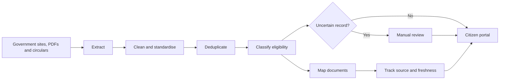

## The challenge

Welfare schemes are spread across hundreds of government sites, PDFs and circulars. Every state publishes information in its own structure. The same scheme can appear on several sites, while eligibility and document requirements are usually written as prose.

Citizens could not easily tell which schemes matched their circumstances. Records also needed to stay useful as schemes changed, closed and reopened, with every claim pointing back to its source.

The work brought together IIT Roorkee and the Social Studies Foundation, an ICSSR-recognised non-profit that supports underserved communities.

## What we built

NewtonSchool Studio built a six-stage data pipeline:

1. Extract source material.
2. Clean and standardise records.
3. Deduplicate repeated schemes.
4. Classify eligibility.
5. Map required documents.
6. Track source and freshness.

AI assists with structuring the source material. Records with uncertain classifications move to manual review.

The citizen portal collects an eligibility profile with state, category, education, BPL status and occupation. Citizens can then filter schemes by state, department and beneficiary group.

## How it works

Puppeteer and BeautifulSoup collect source material. Celery and Redis coordinate background work. Django REST serves the structured records to the Next.js portal, backed by PostgreSQL.

## What made it hard

- Every state used a different publishing structure.
- Duplicate schemes appeared across multiple sites.
- Eligibility rules were embedded in prose.
- Document requirements varied between schemes.
- Schemes changed status over time.
- Every record needed a reliable source and freshness trail.

## Results

The system collected and standardised scheme data from 13 states through six defined processing stages. It was handed over to IIT Roorkee, runs on IIT Roorkee servers and transferred code ownership to the institution.

**Stack:** Puppeteer, BeautifulSoup, Django REST, Next.js, PostgreSQL, Celery, Redis, Docker, AWS EC2, RDS, ALB and ECR, plus Nginx.
