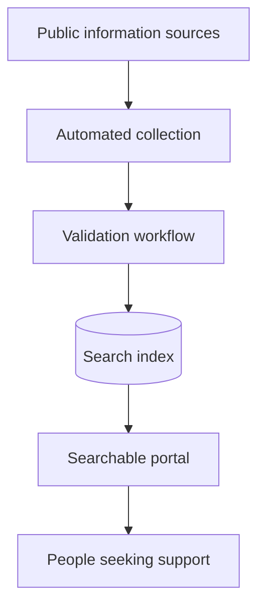

## Information only helps when people can find it

Public welfare schemes are created to reach people who need support. But discovering the right scheme can itself become a difficult task.

Information may be distributed across many public sources, described in different ways and updated independently. A person looking for help has to know where to search before they can even begin to understand what might apply to them.

In collaboration with IITR, NewtonSchool Studio worked on a simpler idea: bring that fragmented information into one place and make it searchable.

## Building a path from source material to search

The result was a central portal supported by an automated collection workflow.

Puppeteer-based collectors gathered information from public sources. A validation step sat between collection and publication, and approved information moved into a search index used by the portal.

The pipeline matters as much as the interface. A search experience can only be useful when the information behind it is collected consistently and prepared for discovery.

## Automation with a review boundary

Automated collection reduces the effort required to monitor multiple sources, but public information should not flow into a user-facing product without control.

The validation stage creates that boundary. It separates gathering information from presenting it, allowing collected material to be reviewed before it becomes searchable.

This pattern also makes the system easier to evolve: new sources can be added to the collection layer without changing the basic experience for the person using the portal.

## A practical platform for public information

Django provided the application layer, while Puppeteer handled browser-based collection workflows. The system was packaged with Docker and deployed using AWS infrastructure.

| Layer | Responsibility |
| --- | --- |
| Collection | Gather scheme information from distributed public sources |
| Validation | Review information before publication |
| Search | Organise approved information for discovery |
| Portal | Give users one place to explore available schemes |
| Operations | Package with Docker and run on AWS |

## What changed

Instead of requiring people to navigate a collection of disconnected sources, the portal created one searchable entry point for welfare-scheme information.

The wider value lies in reducing the distance between a public programme and the person it was designed to support.

<aside class="callout">
  <strong>The outcome</strong>
  
A fragmented information journey became a central, searchable experience supported by an automated collection pipeline.

</aside>

<!-- Editorial follow-up: confirm partner naming, number of schemes and sources, update frequency, user reach, validation process and approved screenshots. -->
