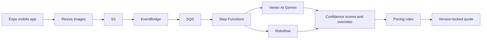

## The challenge

Painting contractors lost hours measuring sites and pricing quotes by hand. Different estimators could price the same work differently. A sent quote is a commercial commitment, so AI-assisted estimates had to remain exact and under the contractor's control.

## What we built

NewtonSchool Studio built FieldVue as one Expo app for iOS and Android. Contractors capture site photos, review room-by-room estimates and control the final price.

Every AI result includes a confidence score and supports a contractor override. Quotes move through a defined lifecycle: draft, priced, ready to send, sent, viewed, accepted or declined. Sending a quote locks that version. Any later change creates a new version.

## How it works

The event-driven pipeline resizes photos from the mobile app and stores them in S3. Vertex AI Gemini and Roboflow run inference. Pricing rules aggregate the detected work into a quote.

EventBridge, SQS and Step Functions coordinate the stages. DynamoDB stores workflow state. Image sizes are tuned to control model cost.

## What made it hard

- Ten site photos had to move through analysis quickly enough for field work.
- Site images vary in angle, lighting and clarity.
- AI output needed visible confidence and an override path.
- Pricing rules had to aggregate room-level results consistently.
- A sent quote had to remain immutable as a commercial record.

## Results

FieldVue analyses 10 site photos in 6 to 7 seconds. Every sent quote is locked, and any change is saved as a new version. One Expo app serves both iOS and Android.

**Stack:** Expo and React Native, AWS EventBridge, SQS, Step Functions, DynamoDB and S3, Vertex AI Gemini and Roboflow.
