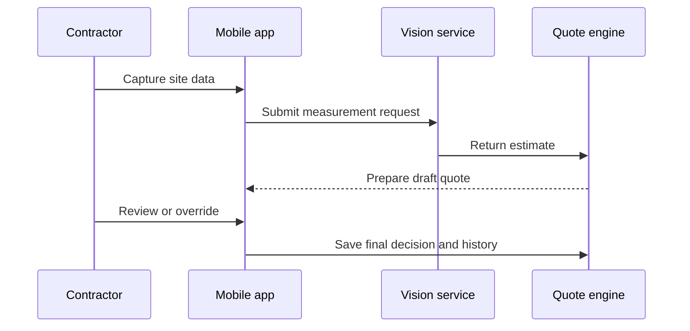

## A quote is only as dependable as the measurement behind it

For a painting contractor, estimating begins long before a price reaches the customer. Someone has to inspect the site, measure the relevant surfaces and translate those observations into a quote.

When that work is done manually, the process can be slow and the result can vary from one estimator to another. Important context may live in photographs, handwritten notes or the estimator's memory. If a number is questioned later, reproducing how the team arrived at it is difficult.

Maverick / FieldVue set out to make that process faster and more consistent without removing professional judgment from the field.

## AI proposes; the contractor decides

NST Studio built a mobile estimation workflow supported by computer vision.

A contractor captures site information in the field. The vision service processes that input, and the quote engine turns the result into a draft estimate. The contractor can then inspect the output, correct it when site conditions demand an override and save the final decision.

The important design choice was to treat AI as part of a controlled workflow—not as an unquestionable answer.

## Why human review is part of the product

Real sites are messy. Surfaces can be obstructed, photographs can be imperfect and local conditions can change what the job requires.

The contractor therefore remains the final decision-maker. An estimate can be accepted or overridden, and that decision remains attached to the quote.

This gives the product four useful properties:

1. The AI creates a consistent starting point.
2. The contractor can apply field knowledge.
3. The original estimate and subsequent override remain visible.
4. The quote can be replayed when it needs to be reviewed.

## An event-driven system behind the mobile workflow

The experience appears as a simple sequence on the contractor's device, but several services have to cooperate behind it.

Vertex AI supports the computer-vision step. Microservices separate the main areas of responsibility, while EventBridge coordinates events as work moves through the estimation and quotation flow.

That separation matters because AI processing, user review and quote generation do not all happen in the same way or at the same speed. The architecture allows those stages to evolve while preserving a traceable end-to-end workflow.

## What changed

The platform turns a manual measuring process into a repeatable digital workflow. Contractors receive AI-assisted estimates without losing control over the final number, and the business retains the history needed to understand how a quote was produced.

<aside class="callout">
  <strong>The outcome</strong>
  
Field estimates became reviewable and reproducible: AI provides the first result, a contractor provides the final judgment, and the system preserves both.

</aside>

<!-- Editorial follow-up: confirm estimation-time reduction, model evaluation method, accuracy figures, quote volume and approved screenshots. -->
