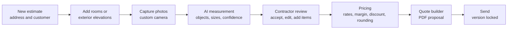
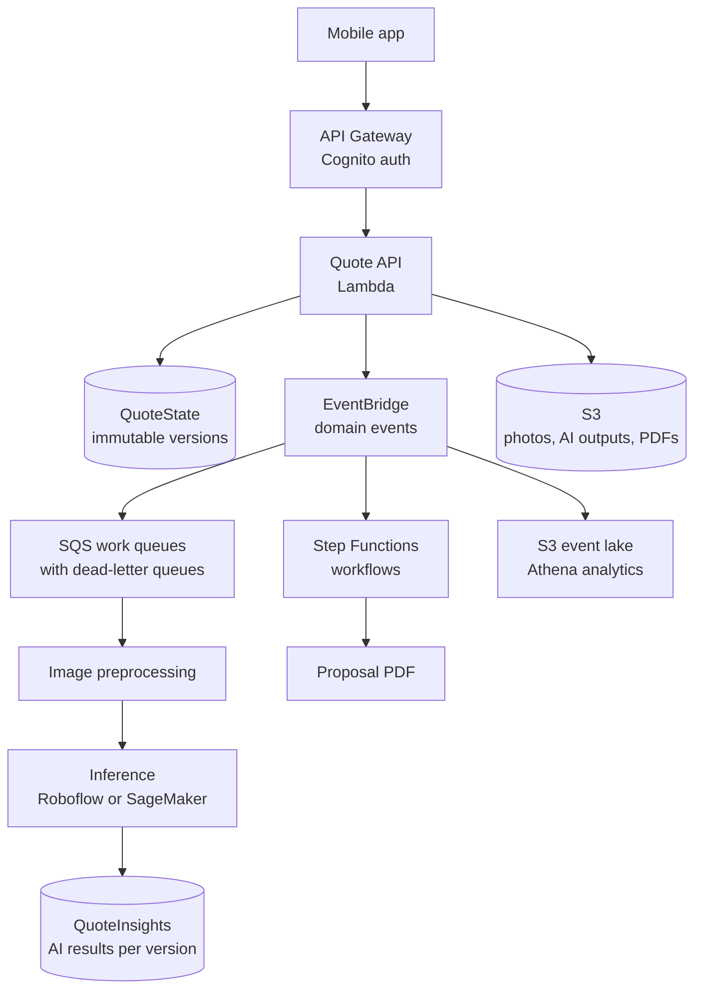

<aside class="callout">
  <strong>At a glance</strong>
  <p><b>Client:</b> Maverick, building FieldVue for painting contractors in North America. <b>Engagement:</b> from July 2025, joining a product already in user testing. <b>Team:</b> two NewtonSchool Studio technical owners and a pod of engineers across AI, mobile and product, working with Maverick's project lead, design lead and an external AI architect. <b>What we did:</b> estimation screens, photo-detection accuracy and cost work, a quote builder with tiered pricing and PDF proposals, mobile builds, and the architecture for the next platform. <b>Principle:</b> the AI suggests, the contractor decides.</p>
</aside>

## Summary

A painting quote looks simple: measure the walls, count the windows and doors, multiply by a rate. In practice, a contractor spends hours on site with a tape measure, then more hours in a spreadsheet, and two estimators looking at the same house will often arrive at different prices.

FieldVue sets out to turn photos of a job into a measured, priced quote. Maverick had already built the first version and proved the photo analysis could be fast. When our pod joined in July 2025, the challenge was different: make the AI accurate enough on real houses, cheap enough to run on every job, and trustworthy enough that a contractor would put their name on the price it produces.

This document covers how we approached that. It explains the business problem, the decision to keep contractors in control of every AI result, how the detection and pricing work, how we controlled AI cost, and the quote-anchored architecture designed for FieldVue's next platform. It is honest about what is built, what is designed and what is still an open risk.

## The problem, in plain language

Contractors in painting and similar trades share the same problems:

- **Estimating is slow and manual.** Measuring every surface by hand takes hours per job.
- **Pricing is inconsistent.** Different estimators price the same job differently, and the business cannot tell which price is right.
- **Scopes are unclear.** It is easy to miss a surface, and hard to show a customer exactly what a price includes.
- **Data is scattered.** Measurements, photos, prices and proposals live in different places, so nothing can be learned across jobs.

Existing tools tend to fail in one of two ways. Some focus on a single trade. Others lean too heavily on AI and try to replace the estimator, which contractors do not trust with a number they have to honour.

Maverick's answer is a product in two tiers:

| Tier | What it is | Role of AI |
| --- | --- | --- |
| FieldVue Core | A quoting engine a contractor can use entirely by hand | None required. It always works |
| FieldVue Smart Vision | AI measurement and pricing suggestions on top of the core | Suggests. The contractor reviews, corrects and decides |

Every quote is meant to become a structured, versioned record. Over time, anonymised data from many quotes, such as pricing patterns, production rates and regional benchmarks, can make the suggestions better for everyone.

## Why this is hard

**A wrong number costs real money.** A quote is a commercial commitment. If the AI misses a wall, the contractor either loses margin or loses the job. If a sent quote changes later, the customer has reason to dispute it.

**Real photos are messy.** Houses vary by region, material, paint pattern and camera angle. A model that works on one style of exterior can fail on another.

**AI cost grows with every photo.** A job can include up to 10 photos. Sending each at full resolution to a large model makes every quote expensive.

**Pricing is not a lookup table.** Contractors price with labour rates, margins, discounts, rounding, surface types and preparation work. A simple rate per square foot cannot represent that.

**The product was already in users' hands.** Changes had to respect Maverick's brand standards and could not disrupt ongoing user testing.

## Where we started

When the pod joined in July 2025, FieldVue already had:

- A mobile app of about 4,000 lines of code, being tested by end users.
- Photo analysis on Google's Vertex AI. Maverick's team had already fine-tuned it from about 35 minutes per job to 6 to 7 seconds.
- Strict brand standards for colours, logo and design elements, and a rule that no existing code changes without approval during testing.

The brief for the pod was to build the estimation experience, improve detection on real jobs, control AI cost, and move pricing and quoting forward, while two NewtonSchool Studio technical owners trained the engineers to work to a North American client's standards.

## Key decisions

### Decision 1: the AI suggests, the contractor decides

Every AI result carries a confidence level, and the contractor can accept it, change its dimensions or add items the AI did not see. The app shows a running total of labour, materials and the customer price as they work, so the contractor sees the effect of every change. FieldVue is AI-assisted estimation, not automated estimation.

### Decision 2: constrain the model instead of asking it to see everything

An open-ended request like "find everything paintable in this photo" produces confident mistakes. We narrowed detection for exteriors to five object types, siding, windows, doors, foundation and railings, with strict definitions of what counts and what does not. The model is told to prefer missing an object over inventing one. A false positive inflates a quote. A miss is caught by the contractor during review.

### Decision 3: spend tokens deliberately

Model cost scales with image size. We measured it and designed the pipeline around it (see "Controlling AI cost" below).

### Decision 4: make the quote the source of truth

Everything, photos, AI insights, prices and proposals, hangs off a quote and a specific version of it. Sending a quote locks that version. Any change after that creates a new version. The customer's copy and the contractor's records can never drift apart, and any price can be traced back to the photos and rules that produced it.

## The product

### The contractor's workflow



1. **Create the job.** Start a new estimate from an address and customer details.
2. **Capture.** Add rooms or exterior elevations as you walk the site and photograph them with the in-app camera. Rooms can be added as you go.
3. **AI measurement.** Photos are analysed for the allowed object types, with sizes and a confidence level for each.
4. **Review.** Accept, adjust or override each measurement, and add service items the AI could not see.
5. **Price.** The pricing engine applies labour rates, margins, discounts and rounding.
6. **Propose.** The quote builder produces a PDF proposal.
7. **Send.** The sent version is locked. The customer can view it and accept or decline.

The estimation screens follow Maverick's interior and exterior estimating forms, which capture surface type, dimensions, material type, paint quantity, preparation requirements, labour factors and price ranges.


### Pricing that matches how contractors think

The first pricing logic looked up a fixed rate per item. Real pricing does not work that way, so it was replaced with a three-tier multiplier model: a base rate adjusted by tiers of multipliers for factors like surface, preparation and complexity. Labour rate, margin, discount and rounding sit on top. Industry benchmarking and upselling of additional service items followed in the quote builder.

### Mobile

One React Native codebase serves iOS and Android, built and distributed through Expo and App Store Connect, with a custom camera for site photos.

## How the detection works

<details>
  <summary>For engineers: designing a detection prompt that contractors can trust</summary>

The exterior detection runs on Gemini through Vertex AI with a structured prompt. Its design principles are worth learning from, independent of the model.

**1. A closed list of object types.** Only siding, window, door, foundation and railing may be returned, and synonyms are mapped to those exact names. "Clapboard", "lap siding" and "fiber-cement" are all siding.

**2. Definitions with visual cues, inclusions and exclusions.** Each type has a definition, the visual cues to look for, what to include and what to exclude. Siding covers wall cladding above the foundation and excludes trim, soffits and gutters. A window needs a visible frame and glass, and reflections do not count.

**3. Sanity rules on geometry.** A foundation sits at the base of the wall, usually in the lower half of the image and usually 5 to 35% of the wall height. Siding must not overlap the roof or extend over windows. When siding sits above a foundation band, they are two objects, not one.

**4. A mandatory check for the most-missed object.** Foundations were easy to miss, so the prompt requires the model to check the base of every wall and report any foundation material it sees.

**5. Conservative measurement.** Dimensions are estimated only when edges are clear, corrected for the camera's zoom level, and sanity-checked against typical sizes, such as an exterior door at 6.5 to 8 feet.

**6. Machine-readable output only.** The model returns JSON and nothing else. Simplified, each object looks like this:

```json
{
  "type": "window",
  "confidence": "high",
  "bounding_box": { "x": 42, "y": 30, "width": 12, "height": 18 },
  "estimated_width_feet": 3,
  "estimated_height_feet": 5
}
```

Confidence has three levels: high when the object is fully visible, medium with minor occlusion, low when partly visible or uncertain. The app shows that level to the contractor, so attention goes where the AI is least sure.
</details>

## Controlling AI cost

Image size drives model cost. For the model used, the approximate token counts for one image were:

| Image resolution | Approximate tokens | Cost relative to 384px |
| --- | --- | --- |
| 384 × 384 | 197 | 1× |
| 768 × 768 | 786 | 4× |
| 1536 × 1536 | 3,145 | 16× |

Sending photos at the highest resolution would make a 10-photo job cost sixteen times more than it needs to, for no gain if the objects are clearly visible at lower resolution. The cost strategy had five parts:

1. **Right tool for the job.** Use a managed model where it earns its cost, and consider smaller or open-source models for simpler steps.
2. **Minimise the payload.** Resize every image to the smallest size the task needs, compress it, and prefer JPEG or WebP over PNG when transparency is not needed.
3. **Structured, constrained prompts.** Short imperative instructions, exact fields and JSON-only output keep responses small and predictable.
4. **Exit early.** Handle most requests at the cheapest tier, and treat escalation to a more expensive step as the exception. Cache repeated context where the platform supports it.
5. **Measure everything.** Track cost per quote, so any change in prompts or images shows up in the numbers.

## The next platform: a quote-anchored architecture

In December 2025 we designed the architecture for FieldVue's move from Google Cloud to AWS. This section describes a design and migration plan, not a finished system.



**Core ideas.**

- **QuoteId** identifies a quote for its whole life.
- **QuoteVersion** is an increasing number. Each version is an immutable snapshot.
- **EventId** makes every event unique, so processing it twice does no harm.
- **Tier 1** is the authoritative manual quote. **Tier 2** AI insights are always attached to a specific version and never overwrite it.

**Data.** Quote snapshots are stored in DynamoDB, keyed by quote and version, so the latest version is one query and any past version is one lookup. A separate table records every event for audit and replay, and another stores AI insights per version and model version. Indexes support a contractor's list of quotes and filtering by status. Operational data such as users, customers, jobs, rooms and room images stays relational. Photos, AI outputs and proposals are stored in S3 under each quote's version.

**Events and workflows.** Every change emits a domain event: quote created, quote updated, photo attached, AI insight generated, quote sent, quote accepted or rejected, proposal generated. A photo upload queues preprocessing and inference. Results are saved against that version and announce themselves with an event. Sending a quote locks the version, generates the PDF and records both events.

**Reliability.** Delivery is at least once, so every consumer is idempotent and keyed by event ID. Failures go to dead-letter queues after three attempts and raise alarms. Insights for any version can be recomputed by replaying its events.

**Performance targets.** p95 quote read within 300ms, p95 update including the event within 800ms, and p95 photo upload start within 300ms, while handling 10 to 50 concurrent photo uploads per contractor session.

**Security.** KMS encryption for DynamoDB and S3, TLS everywhere, least-privilege IAM separated by environment, presigned URLs for uploads and downloads, secrets in Secrets Manager, a web application firewall with per-contractor rate limits, and personal data minimised in analytics.

**Migration plan.** Run AWS in parallel for a subset of projects, then make AWS primary for new quotes while existing quotes stay readable on Google Cloud, then retire the old endpoints once stable.

| Weeks | Milestone | Exit criteria |
| --- | --- | --- |
| 1 | Foundation: accounts, IAM, network, CI/CD, budgets, logging | Secure landing zone ready |
| 2 to 3 | Quote core: DynamoDB, APIs, S3 artifacts, versioning | Versions created, updated and read reliably |
| 4 to 5 | Events and orchestration | Deterministic workflows with retries |
| 6 to 7 | Vision pipeline | Insights tied to quote versions |
| 8 to 9 | Analytics and cutover | AWS primary for new quotes |
| 10 to 12 | Stabilise and decommission | Old endpoints off, metrics stable |

## What went wrong, and what is still open

| Issue | What happened | Status |
| --- | --- | --- |
| Disappearing siding | Siding detected on some exteriors vanished on others | Prompt rewritten around five strict object types, with siding as the top priority for improvement |
| PDF room labels | Proposals showed a placeholder room name | Fixed |
| Small UI defects | Missing close button, status bar icons, an eye icon | Fixed |
| Accuracy on unfamiliar exteriors | Detection was weaker on exteriors unlike its target market and on patterned paint | Open risk. This is why contractor review and confidence levels are part of the design, not an afterthought |

We include the open risk on purpose. Any AI estimation product will meet photos it handles badly. The design question is whether the contractor can see and fix the problem before it reaches a customer. In FieldVue, they can.

## Timeline

| When | Milestone |
| --- | --- |
| July 2025 | Pod joins. Codebase, brand standards and estimating forms reviewed. Team trained for North American client presentations |
| September 2025 | AI cost strategy: resolution, compression, structured prompts, early exit |
| October 2025 | Detection prompt rebuilt around five object types. PDF and UI fixes. New pricing logic received and quote builder development starts |
| December 2025 | Quote-anchored architecture and AWS migration plan drafted. Two more engineers join the pod |

## Results

- **Estimation screens built** from Maverick's interior and exterior estimating forms.
- **Exterior detection constrained to five object types**, each with a bounding box, size estimate and confidence level, and a mandatory check for the most-missed object.
- **AI cost controls** designed around measured token costs, with resizing, compression, constrained prompts and early exits.
- **Pricing moved from a static rate table to a three-tier multiplier model**, with a quote builder and PDF proposals.
- **One app for iOS and Android**, built with Expo and a custom camera.
- **The architecture for the next platform designed**, anchored on immutable quote versions, with a 12-week migration plan.
- Photo analysis stays at **6 to 7 seconds per job**, the speed Maverick's team reached before the pod joined.

## Lessons for engineering teams

- **Design for the human in the loop from day one.** Confidence levels and overrides are what make an AI number usable in a commercial document.
- **Constrain the model.** A closed list of objects with strict definitions beats an open request every time.
- **Prefer a miss to a false positive** when a person reviews the result. A miss is easy to add. A false positive silently inflates a price.
- **Measure token cost before optimising.** Resolution alone changed cost by sixteen times.
- **Version the thing customers see.** If a document carries a price, make every version immutable and traceable.

<details>
  <summary>Glossary for non-engineers</summary>

- **Computer vision:** software that identifies objects in images.
- **Bounding box:** the rectangle drawn around an object the AI has found.
- **Confidence level:** how sure the AI is about a result.
- **Token:** the unit AI models use to measure input and output, and the unit they are billed by.
- **Prompt:** the instructions given to an AI model.
- **Immutable version:** a saved copy that can never be changed. Edits create a new version instead.
- **Event-driven architecture:** a design where each change announces itself, and other parts of the system react to it.
- **Idempotent:** safe to run twice, with the same result as running once.
- **Dead-letter queue:** where failed jobs go so they can be inspected instead of being lost.
</details>

## Stack

React Native, Expo, App Store Connect, Google Vertex AI (Gemini). Designed for the next platform: AWS API Gateway, Lambda, Cognito, DynamoDB, S3, EventBridge, SQS, Step Functions, Roboflow or SageMaker, KMS, Secrets Manager, CloudWatch and X-Ray, Athena.
