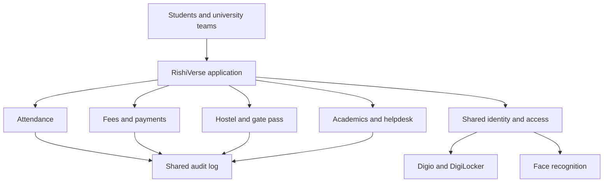

## The challenge

Rishihood University ran attendance, fees, hostel, gate passes, academics and helpdesk as separate, mostly manual processes. Attendance was recorded by hand. Fees needed manual reconciliation. Document checks and KYC slowed onboarding. Each module needed its own access levels, while sensitive actions lacked a clear audit trail.

The university serves 5,000+ students. <!-- TODO(hritvik): confirm -->

## What we built

NewtonSchool Studio built RishiVerse as one ERP with more than 25 modules, including attendance, fees, hostel, gate pass, mess and helpdesk.

The system includes:

- automated attendance marking
- nightly late-fee calculation
- KYC and e-sign through Digio, plus DigiLocker
- face recognition and payment gateways
- retries and audit logs around each external integration
- role-based access for every module
- an audit log on every sensitive action

## How it works

RishiVerse uses a modular monolith. One deployable codebase avoids early network latency, distributed transactions and operational overhead. Clean domain boundaries keep attendance, finance, hostel, academics and other modules separated so they can split out later if scale requires it.

More than 100 REST API endpoints connect the modules and integrations. Workloads run on AWS, with deployments delivered through ECR.

## What made it hard

- Manual attendance and fee processes had to become dependable automated workflows.
- Hostel, gate pass, finance and academics held related data in separate processes.
- Each module required different access rules.
- Identity, face recognition and payment integrations needed retries and audit logs.
- Sensitive changes needed a complete record without slowing daily work.

## Results

RishiVerse reduced manual administrative work by 80% and operates at 99.8% uptime. API response time is below 200 milliseconds at p95 across more than 100 REST endpoints.

**Stack:** Node.js, Express, PostgreSQL, MongoDB, AWS EC2, RDS, S3 and Lambda, with CI/CD through ECR.
