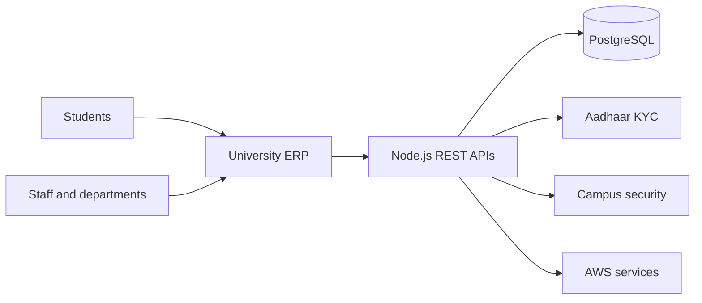

## A university cannot run as 25 separate offices

For a student, university life should feel like one connected experience. Behind the scenes, however, every admission, identity check and administrative request can cross several departments.

At RishiVerse, a university serving more than 5,000 students, many of those workflows still depended on paper records and manual coordination. More than 25 departments had to keep information moving, even when the underlying process was fragmented.

The challenge was not simply to digitise a collection of forms. It was to create a shared operational system that could support the university as a whole.

## From scattered processes to one platform

NewtonSchool Studio built a production ERP that brought core university workflows behind a common application and API layer.

The platform included more than 100 REST APIs, a PostgreSQL data layer and integrations for Aadhaar KYC. It also supported face-recognition workflows for campus security.

This structure gave individual departments the workflows they needed without turning each department into another disconnected system.

## Identity had to work across the system

Identity is not a feature that sits in one corner of a university ERP. It affects onboarding, access and day-to-day administration.

By connecting Aadhaar KYC and campus-security workflows to the same platform, the system could carry identity through the wider student journey. The objective was a more consistent process, with less reliance on repeated paper checks and disconnected records.

## The backend was designed as a foundation

With more than 100 REST APIs, the application layer had to support many workflows without becoming a collection of one-off integrations.

Node.js provided the service layer, PostgreSQL held the operational data and AWS supported deployment. Together, these components formed a foundation that could serve multiple university functions while keeping the interfaces between them explicit.

| Area | What the platform provided |
| --- | --- |
| University operations | Shared workflows across more than 25 departments |
| Identity | Aadhaar KYC integration |
| Campus security | Face-recognition-supported workflows |
| Application layer | More than 100 REST APIs |
| Infrastructure | PostgreSQL-backed services deployed on AWS |

## What changed

RishiVerse moved from paper-led coordination towards a connected operating system for university administration. Students and staff could interact with shared digital workflows, while departments worked through a common platform rather than isolated records.

The result was not just a digital version of the old process. It was an extensible foundation for operating a university at scale.

<aside class="callout">
  <strong>The outcome</strong>
  
One production platform connected administrative, identity and campus-security workflows across a university serving more than 5,000 students.

</aside>

<!-- Editorial follow-up: confirm uptime, reduction in manual administration, delivery timeline and approved screenshots before adding quantitative claims. -->
