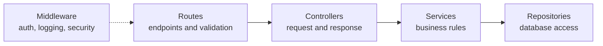
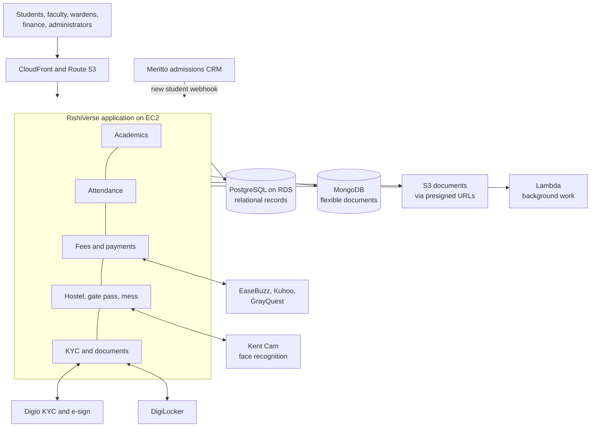
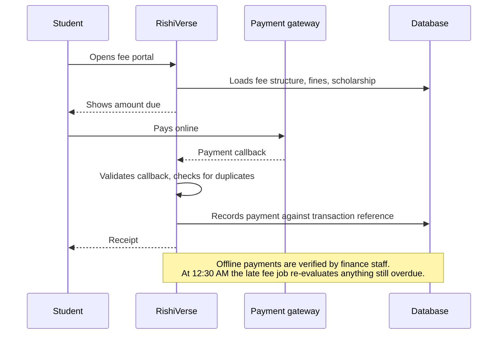
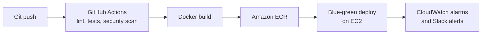

<aside class="callout">
  <strong>At a glance</strong>
  <p><b>Client:</b> Rishihood University, Sonipat, India. <b>What we built:</b> RishiVerse, the university's ERP, covering academics, attendance, fees, hostel, gate passes, mess, helpdesk, identity and documents, plus a learning management system and a rebuilt web frontend. <b>Duration:</b> about one year for the backend, with the frontend rebuild, LMS and fee portals delivered through 2025. <b>Shape:</b> one Node.js application with 25+ modules and 100+ REST endpoints on AWS, and a React and TypeScript frontend. <b>Outcome:</b> 80% less manual administrative work, 99.8% uptime and sub-200ms responses at the 95th percentile.</p>
</aside>

## Summary

Rishihood University needed one system to run the campus. Its operations were spread across spreadsheets, paper registers and separate tools, and the people running them spent their days reconciling those sources by hand.

We built RishiVerse, an ERP that now handles the daily life of the university: who attended which lecture, who paid which fee and when, who left campus and when they came back, which documents a student has verified, and who is allowed to change any of it. It is built as a modular monolith, one application with clear internal boundaries, because that gave the university the reliability of a single system without the cost of running a fleet of microservices before it needed one.

This document explains the problem, the decisions we made, how the system works, what went wrong along the way and how we fixed it. It is written so that an administrator can follow the story and an engineer can learn from the design.

## The problem, in plain language

A university is a small city. It admits students, teaches them, houses them, feeds them, lets them in and out of the gates, collects fees, answers their complaints and keeps records that regulators and parents care about. Each of those jobs has its own team, its own rules and, before RishiVerse, its own way of keeping records.

That created five kinds of daily friction.

1. **Attendance was recorded by hand.** Faculty took attendance on paper or in local sheets, and someone had to compile it. Errors were common, and students and parents found out late.
2. **Fees were reconciled manually.** Payments arrived through gateways, bank transfers and offline channels. Staff matched them to students by hand and calculated late fees every cycle.
3. **Onboarding stalled on documents.** Every new student had to submit and verify identity and academic documents. Checking them took time, and the checks were not always consistent.
4. **Departments did not share data.** Hostel, gate pass, finance and academics each kept their own records, so a simple question like "is this student allowed to leave campus tonight?" meant asking several people.
5. **Sensitive actions left no trail.** When someone changed a fee, approved a gate pass or edited a student record, there was often no reliable log of who did it and why.

The university did not need another tool. It needed one backbone that every department could rely on, that kept data consistent, controlled who could do what, recorded every sensitive action, and kept running as the university grew.

## Why this is hard

On paper, an ERP is a set of forms on top of a database. In practice, three things make it difficult.

**Everything is connected.** A fee depends on a student's program and semester. A gate pass depends on hostel status and attendance. A scholarship changes the fee. When modules are built separately, these connections become manual work. When they are built together carelessly, a change in one module breaks another.

**The outside world is unreliable.** Identity verification, e-signatures, document retrieval and payments all happen in other companies' systems. They respond late, respond twice, fail halfway or disagree with your own records. The ERP has to stay correct even when they misbehave.

**People use it every day.** Students check attendance, pay fees and request gate passes at all hours. Downtime during a fee deadline or at the hostel gate is not an inconvenience. It stops the university.

## Constraints

- **One small team.** A pod of student engineers led by a technical owner, without a dedicated operations team.
- **Live users from early on.** Modules went into use as they were finished, so new work had to ship without interrupting existing work.
- **Regulated data.** Identity documents, Aadhaar-based KYC and financial records had to be stored and accessed carefully.
- **Different permissions everywhere.** Students, faculty, wardens, finance staff and administrators each needed different access in each module.
- **A university budget.** Infrastructure costs had to stay modest and predictable.

## Key decisions

### Decision 1: a modular monolith, not microservices

We built RishiVerse as one deployable application divided into modules with clear boundaries, rather than as many small services talking over the network.

| Option | What it would have meant |
| --- | --- |
| Microservices | Independent scaling per module, but network calls between modules, service discovery, authentication between services, transactions that span services, and many deployments to run and monitor. |
| Modular monolith (chosen) | One codebase and one deployment, transactions that stay inside one database, simpler operations, and modules that can still be extracted later if one needs to scale on its own. |

For a university with tens of thousands of requests a day, the extra moving parts of microservices would have cost more than they returned. The modular monolith gave us one place to enforce rules like "every fee change is logged", while keeping each module's code separate enough that a team could work on hostel logic without touching finance.

### Decision 2: a strict layered structure inside every module

Every module follows the same layers:



Routes define the endpoints, controllers handle requests, services hold the business rules and repositories talk to the database. Cross-cutting concerns such as authentication, logging and security live in middleware. Because every module looks the same, a new engineer can find their way around any module after learning one.

### Decision 3: automate the repetitive work on a schedule

The most expensive manual work happened on a fixed rhythm: attendance every day, late fees every night, hostel check-ins every evening. Instead of building screens to make that work faster, we removed it with scheduled jobs.

| Job | When it runs | What it does |
| --- | --- | --- |
| Attendance marking | 6:00 PM daily | Marks students absent where attendance was not recorded, updates records and notifies students and parents. A grace period and a manual override protect against wrong marks. |
| Late fee calculation | 12:30 AM nightly | Evaluates overdue payments against configurable fee rules, applies penalties, generates a report and sends reminders. Scholarship students follow their own rules. |
| Late check-in tracking | 9:30 PM daily | Reads gate pass data, identifies students who returned late, updates records and notifies wardens and parents. |

These three jobs are the main source of the 80% reduction in manual administrative work.

### Decision 4: treat every external integration as unreliable

KYC, e-signatures, document retrieval and payments all depend on outside providers. We built each integration with the assumption that it would fail sometimes: webhooks are validated, every request has a tracked status, retries use exponential backoff, and every call is logged so a failure can be traced and replayed.

## The system

### Modules

RishiVerse has more than 25 modules. Grouped by what they do:

- **Core:** authentication with JWT, role-based access control, user management and the student information system.
- **Academics:** schools and departments, programs, courses, sections, lectures with recurring schedules, and the academic calendar.
- **Student life:** attendance (lecture-wise, with QR code attendance through the Kent Cam integration and attendance analytics), gate pass and exit management, hostel room allocation, mess, room booking, clubs, notice board, directory, complaints and the help centre.
- **Finance:** fee structures per program and semester, payment tracking against transaction references, offline payment verification, fines, scholarships, late fees, and separate fee portals for students and administrators.
- **Identity and documents:** Aadhaar-based KYC and e-signatures for student undertakings through Digio, verified document retrieval through DigiLocker, and face-recognition campus access through Kent Cam.
- **Administration:** faculty management and workload, infrastructure and maintenance requests, digital undertakings with student and parent e-signatures, program manager tools, system-wide settings and feature flags, approvals and reporting.
- **Learning:** a learning management system with student and faculty interfaces, recurring lecture scheduling and a unified calendar.


### The frontend and the learning management system

The backend was only half of what people touch. In 2025 the web frontend was rebuilt as a second version in React and TypeScript, with a shared component library for data tables, notices, profile views and headings, so every module looks and behaves the same way. Students see their attendance, fees, notices and requests in one dashboard. Administrators get searchable, sortable, paginated tables built for thousands of records.

On top of that we built a learning management system. It started in July 2025 with requirements and wireframes, worked through with the university's academic team and an external design studio, and the student and faculty interfaces followed in August. Around it:

- **Recurring lectures.** Faculty schedule a lecture once and it repeats, with bulk actions and search.
- **A unified calendar.** Agenda and calendar views of lectures and events, with overlap detection so two events cannot quietly collide.
- **Attendance analytics.** A dashboard with filters by status, so faculty and program managers can see patterns, not just records.
- **Program manager tools.** A separate mode for program managers to move between their own view and the programs they run.
- **Fee portals.** An admin module for fee structures, payment processing, payment records and scholarships, and a student portal with payment history and live fee status. Fee collection went live in December 2025.

In November 2025 the codebase moved from its first architecture to a second, refactored version, to keep it maintainable as modules kept arriving.

### Real university rules the system had to encode

An ERP succeeds or fails on the rules nobody writes down until something breaks. A few that came out of working sessions with the university:

- **Document approval needs a way back.** Students had no option to re-upload a rejected document, and a rejection needed a clear message. Approval now ends in one confirmation email when everything is verified, and rejections are communicated with a path to fix them.
- **Student status changes access.** Dropped, suspended, rusticated and terminated students need different access. A suspension blocks email and RishiVerse access for a set period, without deleting the student.
- **Default passwords are a risk.** New students could not all start with the same password, so onboarding was changed to issue credentials safely when students arrive on campus.
- **Not everything needs approval.** Requests that do not need sign-off became simple choices, so administrators only review what matters.

None of these is technically hard. All of them matter more to the university than any framework choice.

### Architecture



**Two databases, chosen deliberately.** PostgreSQL holds the relational core: students, programs, courses, sections, attendance, fee structures, payments and gate passes, where consistency and joins matter. MongoDB holds records whose shape varies, where forcing a rigid schema would add friction.

**Documents never get a permanent public link.** Identity and academic documents live in S3. Instead of storing permanent URLs, a middleware layer replaces every S3 link in an API response with a presigned URL that expires after a configurable time. A leaked link stops working on its own.

**New students arrive automatically.** When a student is admitted in the admissions CRM, Meritto sends a webhook and RishiVerse creates the student's account and profile. Nobody re-types admission data.

### How a fee payment flows



### Security

- JWT authentication and role-based access per module.
- Passwords hashed with bcrypt.
- Rate limiting, input validation and CORS protection on the API.
- Presigned, expiring URLs for every document.
- Soft deletes and audit logs, so records are never silently lost and every sensitive change is attributable.
- A sensitive-column audit and data masking for the test database, so engineers never work on real personal data.

The system passed a security audit with zero critical vulnerabilities.

### How it ships and stays up



Every change runs through GitHub Actions: linting, unit and integration tests with a 70% coverage threshold, and dependency and security scanning. A Docker image is built, pushed to Amazon ECR and deployed with a blue-green strategy. The new version starts alongside the old one, is tested, and receives traffic gradually, 10%, then 50%, then 100%. If error rates rise, traffic moves back. Infrastructure is defined with Terraform, and production and staging run on separate instances. Production deployments wait for a manual approval after staging smoke tests pass, and any previous Docker image can be redeployed for a rollback.

<details>
  <summary>For engineers: the AWS setup in detail</summary>

- **Compute:** Ubuntu EC2 instances behind an Application Load Balancer, with security groups restricted to what each service needs, auto-scaling for traffic spikes, health checks and Elastic IPs.
- **Database:** PostgreSQL on Amazon RDS with encryption at rest, automated daily backups kept for seven days, Multi-AZ for availability, read replicas for read-heavy work and tuned parameter groups. Prisma is the ORM, with raw SQL where a query needs it.
- **Storage:** separate S3 buckets for student documents, profile pictures, notice attachments, and backups and logs, each with server-side encryption, versioning, access logging and lifecycle rules. CloudFront serves assets over TLS.
- **Background work:** Lambda functions for image compression, email and SMS notifications, report generation and data clean-up, triggered on schedules through EventBridge.
- **Access:** IAM roles per service with least privilege, MFA for production access and separate deployment credentials for CI/CD.
- **DNS:** Route 53 with health checks and failover routing.
- **Containers:** multi-stage Docker builds on a slim Node.js base image to keep images small, and Docker Compose with PostgreSQL and Redis for local development.
- **Observability:** Winston structured logs for HTTP requests, database queries, authentication events, scheduled jobs and errors, shipped to CloudWatch Logs with retention policies and CloudWatch Insights. Dashboards cover latency, error rates by endpoint, database performance and resource use, with alarms on CPU above 80%, memory exhaustion, error spikes and database connection failures.
</details>

<details>
  <summary>For engineers: how the backend handles failure</summary>

**Webhooks with retries.** Digio's KYC flow is asynchronous: a verification starts, and the result arrives later as a webhook. Early on, out-of-order or repeated callbacks left verifications in inconsistent states. We added webhook validation, a status record for every verification request, and retries with exponential backoff, plus detailed logs so a stuck verification can be traced.

**Crash safety.** Unhandled exceptions are logged with context and trigger a graceful shutdown, and PM2 restarts the process. Unhandled promise rejections are logged rather than ignored.

**Scheduled jobs that cannot fail silently.** Every cron job logs its run to the database, raises a CloudWatch alarm on failure and posts success or failure to Slack. A late fee job that did not run is visible the same night, not at the next audit.

**Simplified illustration of the late fee rule.** This is not production code. It shows the shape of the logic.

```ts
// Runs nightly at 12:30 AM
for (const due of await fees.findOverdue(today)) {
  if (due.student.hasScholarshipExemption) continue;
  const rule = feeRules.forProgram(due.programId, due.semester);
  const penalty = rule.penaltyFor(daysLate(due.dueDate, today));
  await fees.applyLateFee(due.id, penalty, { reason: "nightly-late-fee" });
  await audit.log("LATE_FEE_APPLIED", { feeId: due.id, penalty });
}
```

The rules live in the database, not in code, so finance can change a penalty without a deployment.
</details>

## What went wrong, and how we fixed it

| Problem | What we changed | Result |
| --- | --- | --- |
| 25+ modules started depending on each other in tangled ways | Clear service boundaries, shared utilities and consistent API contracts between modules | Modules could change without breaking each other |
| Digio KYC callbacks arrived late, twice or out of order | Webhook validation, a status record per request, retries with exponential backoff | Verifications reach a consistent final state |
| Permanent document links were a security risk | Middleware that swaps S3 links for expiring presigned URLs | Leaked links expire on their own |
| Students were sometimes marked absent wrongly | A grace period before the 6 PM job, manual override, audit log and dispute notifications | Fewer wrong marks, and every correction is traceable |
| Late fee rules had tiers and exceptions | Fee rules moved into configuration, with a rule engine and scholarship handling | Finance changes rules without engineering |
| Heavy reports took 3 to 5 seconds | Indexes on frequently queried columns, optimised joins and Redis caching | Report queries under 500ms |
| Deployments caused short outages | Blue-green deployment with health checks and instant rollback | Zero downtime across the last 50+ deployments |
| AWS costs were higher than they needed to be | S3 lifecycle policies, right-sized RDS, auto-scaling and CloudFront caching | Monthly AWS cost down by about 45% |
| Scheduled jobs could fail without anyone noticing | Per-job logging, CloudWatch alarms and Slack notifications | Failures are visible the same night |

## How we worked

The engineering practice mattered as much as the architecture, because the system kept growing while people used it.

- **Requirements first.** Major modules started from a written product requirement document: student management, attendance, fee management, gate pass and exit management, and mess management. Each covered user stories, acceptance criteria, data models and API contracts.
- **Design reviews before code.** Six formal reviews covered the overall architecture, API design, security, database design, third-party integrations and the scheduled jobs.
- **A disciplined Git workflow.** Separate branches for production, staging, integration, features, bug fixes and hotfixes. Commit messages follow a conventional format. The main branch is protected: every change needs at least one review approval and passing CI checks.
- **Shared standards.** ESLint and Prettier with pre-commit hooks, consistent naming, and one structure for every module.
- **A weekly rhythm with the university.** A fixed weekly sync with the university's program managers and the NewtonSchool Studio leads, plus focused sessions with hostel, academic and finance teams as each module was designed.

## Timeline

| When | Milestone |
| --- | --- |
| 2024 to 2025 | Backend built module by module over about a year: core, academics, attendance, fees, gate pass, mess, KYC and documents |
| May 2025 | Payment gateway integration planned with EaseBuzz. Admissions webhook from Meritto live. Hostel room allocation algorithm built |
| June 2025 | Frontend rebuild and the student fee dashboard begin |
| July 2025 | Upcoming-fee module completed. LMS requirements, architecture and wireframes |
| August 2025 | LMS student and faculty interfaces. Attendance analytics, recurring lectures and calendar |
| November 2025 | Codebase refactored from the first to the second architecture. Fee module enhanced |
| December 2025 | Admin and student fee portals merged. Fee collection live |

## Results

- **80%** less manual administrative work, mainly from automated attendance, late fees and check-in tracking.
- **99.8%** uptime in production over a six-month period.
- **Under 200ms** API response time at the 95th percentile.
- **100+** REST API endpoints, all documented in Swagger.
- **Deployment time cut from 2 hours to 15 minutes**, with zero downtime across the last 50+ deployments.
- **AWS cost down about 45%** through right-sizing, lifecycle policies and caching.
- **Report queries brought under 500ms** from 3 to 5 seconds.
- **More than 5,000 students** supported, with over 50,000 API requests a day.
- **Fee collection live** in December 2025.

## Handover and documentation

The university received more than the code. The handover included Swagger documentation for every endpoint, an architecture document, a database design document with entity relationships and indexing strategy, DevOps guides, deployment runbooks for emergencies and rollbacks, and knowledge-transfer sessions. Business intelligence and reporting run on Metabase, so administrators can answer their own questions without new code.

## Lessons for engineering teams

- **Start with a modular monolith when the team is small.** You keep the option to split later, and you avoid paying for distributed systems before you need them.
- **Automate the rhythm, not just the screen.** The biggest savings came from jobs that run on their own, not from faster forms.
- **Assume every integration will misbehave.** Status tracking, idempotent handling and retries are cheaper than investigating a wrong record later.
- **Make silent failures loud.** A scheduled job without an alarm is a future incident.
- **Put business rules in configuration.** When finance can change a rule without a deployment, the system keeps up with the university.

<details>
  <summary>Glossary for non-engineers</summary>

- **ERP:** enterprise resource planning, one system that runs an organisation's core operations.
- **Modular monolith:** one application divided into separate modules, deployed as a single unit.
- **Microservices:** many small applications that each do one job and talk over the network.
- **API endpoint:** a specific address that other software calls to read or change data.
- **Webhook:** a message one system sends another when something happens, for example "payment received".
- **KYC:** know your customer, verifying that a person is who they say they are.
- **Presigned URL:** a temporary link to a private file that stops working after a set time.
- **Blue-green deployment:** running the new version beside the old one and switching traffic over gradually, so users never see downtime.
- **95th percentile (p95):** 95 out of 100 requests are at least this fast.
</details>

## Stack

Node.js, Express, Prisma, PostgreSQL, MongoDB, Redis, React, TypeScript, AWS (EC2, Application Load Balancer, RDS, S3, Lambda, EventBridge, CloudFront, Route 53, CloudWatch, IAM, ECR), Docker, GitHub Actions, Terraform, PM2, Winston, Jest, ESLint, Prettier, Snyk, Swagger, Metabase, Digio, DigiLocker, EaseBuzz, Kuhoo, GrayQuest, Kent Cam, Meritto.
