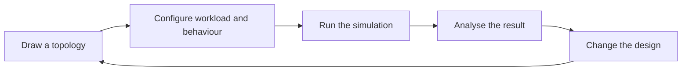
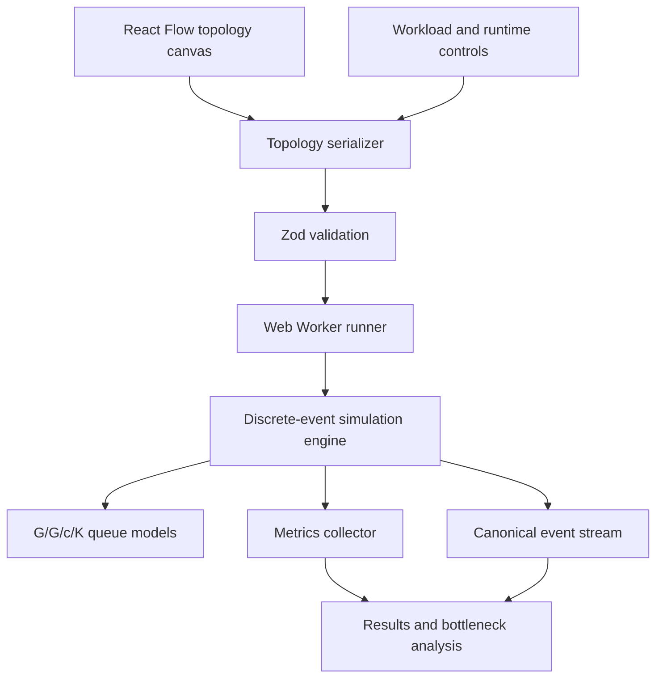

## A diagram can describe a system. It cannot tell you what happens next.

Most system-design work ends with boxes and arrows. A load balancer points to an API service, the API points to a database, and the design appears complete.

But the difficult questions begin after the diagram is drawn. What happens when traffic spikes? Where does a queue begin to grow? Which timeout fires first? Does a retry improve availability or add more pressure to an already saturated service?

Answering those questions usually requires infrastructure, traffic generation and observability tooling. That makes experimentation expensive at the point when a design is still easiest to change.

NST Studio built the System Design Simulator to make those questions testable earlier.

## From a static topology to a running experiment

The simulator lets a user draw a distributed system, configure how its components behave and run workloads through the resulting model.

Instead of provisioning real servers, the user can inspect latency, throughput, queues, utilisation and failures inside a deterministic simulation.

This turns system design into a loop. Build an idea, test it, inspect what happened and try again.

## The workflow begins on a canvas

Users assemble a topology from components such as API servers, databases, caches and load balancers. Each component represents behaviour, not just a shape.

The user can configure queue capacity, worker count, service-time distributions, timeouts, routing and resilience controls. Workload settings describe the traffic entering the system, while a simulation seed makes the experiment reproducible.

Once the topology passes validation, the simulator runs it in a Web Worker so that the computational work stays away from the main interface.

## Determinism makes comparison possible

Real distributed systems contain randomness. Service times vary, requests arrive at different moments and failures do not unfold in exactly the same way twice.

The simulator models that variation with a seeded pseudo-random number generator and deterministic microsecond scheduling. Run the same topology, workload and seed, and the same event sequence is produced.

That repeatability changes the kind of questions a team can ask. If a cache is added, a queue is resized or a timeout is shortened, the new result can be compared against the old one without the experiment itself moving underneath them.

## Inside the simulation engine

The application serialises the canvas and runtime controls into a topology definition. Zod validates that definition before it reaches the discrete-event simulation engine.

The engine advances through scheduled events rather than wall-clock time. Queue models capture capacity, concurrency and service behaviour, while the metrics layer records what the simulated requests experience.

| Area | Implementation |
| --- | --- |
| Interface | React, TypeScript, React Flow and Tailwind CSS |
| State and validation | Zustand and Zod |
| Runtime | In-repository discrete-event simulation engine |
| Queue model | Configurable G/G/c/K nodes |
| Execution | Web Worker for off-main-thread simulation |
| Delivery | Browser application and Electron desktop shell |
| Verification | Vitest and scripted CLI runs |

## Results need to explain the system, not just score it

A single success rate cannot explain why an architecture behaved the way it did. The simulator exposes several views of the same run:

- Latency percentiles from P50 to P99
- Throughput, timeouts, rejections and availability
- Per-node utilisation and queue depth
- Bottlenecks and SLO breaches
- Little's Law, conservation and warm-up checks
- A replayable event stream with per-request traces

Together, these outputs connect the summary back to the topology. A team can see not only that latency rose, but where work accumulated and which events led to the result.

## What changed

The System Design Simulator makes architecture behaviour available before production infrastructure exists.

Teams can run the same experiment repeatedly, compare alternatives on equal terms and examine the mechanics behind a bottleneck or failure. A diagram becomes a hypothesis—and the simulator provides a way to test it.

<aside class="callout">
  <strong>The outcome</strong>
  
Distributed-system designs can be explored as repeatable experiments, with workload, failure and architectural changes evaluated before infrastructure is provisioned.

</aside>

<!-- Editorial follow-up: add approved product screenshots, example experiment results and user feedback when available. -->
