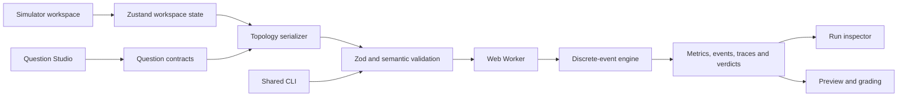

## What was stuck

Most system-design work stops at a diagram. A load balancer points to an API service, the service points to a database, and the design appears complete.

The questions that determine whether the design will work are still unanswered:

- What happens when traffic arrives faster than a service can process it?
- Where does a queue form, and how quickly does it fill?
- Does a retry recover a request or increase pressure on a failing dependency?
- Which timeout or capacity limit becomes the first constraint?
- How does the design behave when a node, zone or network path fails?

Answering those questions with real infrastructure requires deployment, traffic generation and observability. That is expensive when the architecture is still being explored and easiest to change.

The learning problem is equally difficult. A system-design submission cannot be evaluated fairly by checking whether it contains the expected boxes. Two diagrams with similar components can behave very differently because of capacity, routing, workload and failure assumptions.

The project needed to turn a system diagram into an executable hypothesis.

## Constraints

The simulator had to balance breadth, repeatability and honesty.

- A run needed to be reproducible so two architecture variants could be compared under the same conditions.
- The visual workspace, command-line tools and grading system could not develop separate simulation semantics.
- Large simulations had to run without blocking the browser interface.
- The model needed to expose queueing, latency, routing, resilience and failure behaviour without pretending to be a deployment emulator.
- Results needed to explain where a problem originated, not only report a final score.
- Learners, advanced users and question authors needed different levels of control without creating separate products.
- Saved topologies, questions, attempts and evaluation results needed explicit, versioned contracts.

## What we decided

We designed the product around one executable topology contract rather than around the canvas.

The React Flow workspace is the authoring surface. Before a run begins, the design is serialised into `TopologyJSON` and checked with Zod and semantic validators. The same validated topology is then consumed by the browser worker, the command-line interface, question previews and grading tools.

This created a few important boundaries:

| Decision | Reason |
| --- | --- |
| One TypeScript engine | Browser runs, CLI runs and grading use the same behaviour. |
| Seeded discrete-event simulation | The same topology, workload and seed reproduce the same event sequence. |
| Virtual microsecond time | The engine can process system events without waiting for wall-clock time. |
| Web Worker execution | Simulation work stays away from the main interface. |
| Schema and semantic validation | Invalid, ignored and unsupported settings are reported before they can produce misleading results. |
| Versioned question packages | Learning constraints, scenarios and grading rules travel with the assignment. |

## The system

The shipped product has two browser surfaces and one shared command-line runtime.

- **Simulator:** build, run, debug, compare and grade distributed-system designs.
- **Question Studio:** author, preview, verify and export simulator-backed learning activities.
- **CLI:** validate, simulate, compare, lint, estimate cost and evaluate topologies in scripts or CI.



### Building architecture as data

Users construct a system on a drag-and-drop canvas. The current catalogue contains 82 templates across compute, networking, storage, messaging, security, infrastructure, data and AI, resilience, configuration and observability.

Each node represents behaviour rather than decoration. Depending on the component, a user can configure:

- Instance capacity, worker pools and queue limits
- Service-time distributions and processing behaviour
- Request mixes, routing policies and workload profiles
- Network latency, bandwidth and connection constraints
- Timeouts, retries, circuit breakers, rate limits and load shedding
- Cache, replication, consistency, sharding and message-delivery behaviour
- Fault domains, failure injection, recovery and SLO targets

The simulator identifies defaults and descriptive properties so a setting that does not affect runtime behaviour is not presented as simulated evidence.

### Running the system in virtual time

The engine uses seeded, microsecond-resolution discrete-event scheduling. It advances from one scheduled event to the next rather than running each simulated request in real time.

Configurable G/G/c/K queues represent capacity, concurrency and waiting. Workloads can be constant, Poisson, spiky, diurnal, bursty, sawtooth, trace-based or closed-population. Requests can move synchronously, asynchronously, through streams or through routing-aware paths.

This makes controlled comparison possible. A user can change one architecture decision and run both designs with the same seed:

```bash
npm run sim -- compare baseline.json candidate.json --seed 42
```

The comparison keeps the experiment stable while the design changes.

### Explaining what happened

A single success rate cannot explain a distributed system. The analysis layer connects the run summary back to individual nodes, edges and requests.

The product reports:

- End-to-end latency percentiles, throughput, errors and availability
- Per-node utilisation, queue depth, wait time and service time
- Network and connection latency by edge
- SLO breaches, error-budget status and invariant violations
- Bottlenecks, architecture anti-patterns and single points of failure
- Request outcomes, trace waterfalls and replayable event logs
- Failure cascades and a causal graph of the run
- Cost estimates and design-to-design comparisons

The engine also checks its own results. Conservation checks reconcile arrived, completed, failed and in-flight work. Little's Law checks compare observed queue behaviour with the corresponding queueing relationship. Warm-up checks flag runs that begin measuring before the system has settled.

### Turning the simulator into a learning system

Question Studio uses the same runtime to create system-design activities with executable evidence.

Authors define the problem, expected scale, constraints, starting design, workload scenarios, fault experiments and grading obligations. They can then preview the learner experience and export a versioned question package.

Questions can be evaluated through a combination of:

- Structural and semantic topology rules
- Metric and SLO thresholds
- Scenario and chaos-experiment results
- Written design justifications
- Explicit rubric checks

Classroom, Guided and Architect modes control how much complexity a learner sees while preserving the same underlying engine and contracts.

## How we validated it

Validation was designed at three levels.

### Engine behaviour

Vitest tests cover deterministic scheduling, queues, workloads, routing, storage, caching, replication, messaging, failures, resilience controls, metrics and grading behaviour. Fixed seeds protect repeatability, while numerical checks catch internal inconsistencies.

### Interface and engine parity

Playwright journeys exercise the main system-design chapters from the component library through simulation, failure injection, results and grading. Run-based flows compare what the engine produced with what the user sees in the interface.

### Shared contracts

The CLI runs the same engine against the same `TopologyJSON` used by the browser. Question packages and learner submissions pass through versioned validation before grading. This prevents a browser-only interpretation from drifting away from scripted evaluation.

## What went into production

The production web bundle includes:

- The visual topology workspace and component catalogue
- Workload, resilience, failure and simulation controls
- Off-main-thread deterministic simulation
- Run summaries, node and edge metrics, traces, failures and event analysis
- Sample architectures and browser project persistence
- Classroom, Guided, Architect and hosted assignment experiences
- Question Studio for authoring, previewing and exporting activities

The repository also ships a headless `sim` CLI for validation, simulation, comparison, linting, cost analysis and batch evaluation. Both surfaces use the same engine code and topology format.

## What changed

The simulator changes a system diagram from a final answer into the start of an experiment.

A learner or engineer can state a hypothesis, configure the conditions, run the system, inspect the evidence and change the design. An instructor can evaluate the resulting architecture through behaviour and constraints rather than visual similarity alone.

No public adoption or learning-impact metrics have been approved for this case study yet. The current evidence is the implemented product, its shared runtime contracts and its verification system.

## Handover and limitations

The simulator is a model, not a deployment emulator. A result is only as useful as the topology, workload and component assumptions supplied to it.

It does not replace production load testing, security testing or operational observation. Its role is to make assumptions explicit, compare alternatives under controlled conditions and expose likely bottlenecks or failure paths before infrastructure is provisioned.

Component settings that do not currently affect runtime behaviour are treated as descriptive or reported as unsupported. That boundary is deliberate: the product should not present an unimplemented behaviour as evidence.

<aside class="callout">
  <strong>The outcome</strong>
  <p>System designs can be built, simulated, compared and graded as reproducible experiments before production infrastructure exists.</p>
</aside>

<!-- Editorial follow-up: add approved product screenshots, a representative comparison run and user or instructor feedback when available. -->
