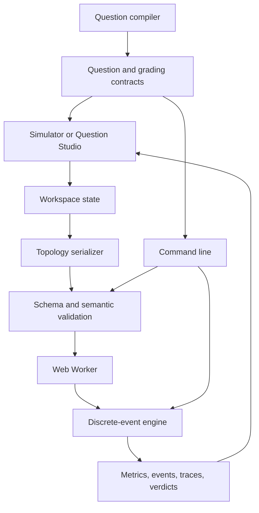

<aside class="callout">
  <strong>At a glance</strong>
  
<b>Client:</b> Newton School of Technology, for its system design teaching. <b>What we built:</b> the System Design Simulator, a browser-based canvas and discrete-event simulation engine, plus Question Studio for instructors, automated grading and a command-line tool. <b>Team:</b> Newton School of Technology student engineers under a NewtonSchool Studio technical owner, 13 contributors and 900+ commits since December 2025. <b>Scale:</b> about 154,000 lines of TypeScript, 82 component templates and 275+ documentation files. <b>Principle:</b> no number without a why. Every result must be reproducible, explainable and consistent with theory.

</aside>

## Summary

Every distributed system design is a prediction. Where will queues form? Which component saturates first? How does one slow dependency turn into tail latency? What happens when a node fails? On a whiteboard, none of these can be observed. The diagram looks the same at 40% load and at 95%.

Newton School of Technology wanted students to see the answers rather than be told them. We built a simulator where a student draws an architecture, sets the traffic and presses Run. A discrete-event engine sends thousands of requests through the design and reports latency percentiles, throughput, utilisation, errors, cost, single points of failure and the first component to break.

A simulator is only useful if its numbers can be trusted, so most of the engineering went into proving them. The engine is deterministic from a seed, checks itself on every run, and is tested against nineteen closed-form results from queueing theory. The same engine runs the canvas, the command line and the grader, so a student, an instructor and a script always see the same answer.

## The people it serves

**Students** build a design, run it, read the bottlenecks and iterate until they meet the targets for latency, throughput and error rate.

**Instructors** define a scenario, its constraints and its grading rules, preview what a student will see, and export a versioned question package for Newton's assignment system.

**Automation and CI** validate, lint, cost, compare and grade designs from the command line, with machine-readable output.

## The problem, in plain language

Students are told that "adding a cache protects the database", but they never see the arrival rate at the database fall. They are told that "a retry storm can take down a healthy dependency", but they have nowhere safe to cause one. Real experiments are expensive, risky and impossible to repeat. Whiteboard reasoning is cheap but cannot be checked.

The existing options each miss part of the problem:

| Approach | Strength | Why it was not enough |
| --- | --- | --- |
| Whiteboards and diagram tools | Fast and familiar | Not executable. Every number is a guess |
| Load-testing tools | Measure real systems | Need a built, deployed system. Costly and not repeatable at will |
| General simulation libraries | Flexible | Need programming. No component library, canvas or grading |
| Cloud research simulators | Validated for data-centre scheduling | Built for virtual machine scheduling, not interactive service design |
| Chaos engineering platforms | Real fault injection | Run on live infrastructure. Unsuitable for learning |

What was missing was a design you could execute: visual enough for a student, repeatable enough to grade, and accurate enough to trust.

## Why this is hard

| Difficulty | What it means in practice |
| --- | --- |
| Real systems are random | Arrivals, service times and failures vary. A tool that gives a different answer every run cannot grade anyone fairly |
| Behaviour compounds | Retries multiply across layers. A failed cache sends its full load to the database. The important failures come from interactions |
| Averages hide the tail | A system can look healthy on average while one component is saturated and its 99th percentile is measured in seconds |
| A plausible model can still be wrong | If the engine is wrong about queueing or recovery, students learn something false with confidence |
| Too much detail hides the lesson | A component can have dozens of settings. A beginner who sees all of them learns nothing |
| It has to run in a browser | Students use ordinary laptops, inside another product, with no server doing the work |

## Key decisions

### Decision 1: determinism is the product

The engine uses an integer microsecond clock to avoid floating-point drift, a min-heap event scheduler with an explicit tie-breaking order, and a seeded random number generator with independent streams for each purpose. The same design and seed always give the same result. Because two designs can be run on exactly the same random inputs, a comparison shows the effect of the design and not sampling noise. This is what makes grading fair.

### Decision 2: one engine everywhere

The canvas, a Web Worker, the command-line tool, the grader and Question Studio all use the same TypeScript engine and the same `TopologyJSON` design format. There is no second implementation for the browser. A result a student sees is exactly what the grader computes, and an instructor can grade a batch of submissions from the command line with the code students ran.

### Decision 3: principles written down before features

Early in the project, the team wrote down the rules every feature, specification and review would be checked against. The final set has 35 named principles in six groups.

| Group | Concern | Example principles |
| --- | --- | --- |
| Truth of the model | What the engine may pretend | Nodes must be true. Failure is injected, never ambient. Model it honestly or do not model it |
| Truth of the numbers | Whether results can be trusted | No number without a why. Determinism is the product. Conservation always balances |
| Structure of the presentation | How results are organised | The verdict comes first. Show the flow, not just totals |
| Teaching | How people learn | Compare, don't just run. Two minutes to meaning |
| Engineering discipline | How work ships | Every behaviour ships with its demonstration. Errors are never console-only |
| Visualisation | What motion means | Every pixel of motion encodes a simulated quantity |

A separate decision sheet of 56 recommendations, covering tolerances, distributions, network latency conventions and workload models, was reviewed and accepted, and each one was implemented or documented.

### Decision 4: a model, honestly labelled

Each component is a general queue with configurable workers, capacity and service-time distribution, extended with behaviour for caching, circuit breaking, autoscaling, replication, sharding and messaging. It does not run application code. Failure rates, packet loss and jitter default to zero. When a setting has no effect, the interface says so: a run warning tells a student that a database's processing time is ignored because data stores take their timing from a storage profile.

### Decision 5: grading that rewards the right idea

Grading combines structural rules, placement rules, metric thresholds under scenarios, rubric checks, chaos experiments and written justifications, deterministically by default. Every question ships with a reference design that must pass every check and a plausible but wrong "gamed" design that must fail the intended one. That pair proves a question rewards the idea it is teaching, not just any design that happens to pass.

## The system

### Architecture

The simulation runs in a Web Worker with a typed protocol, so the canvas stays responsive while millions of events are processed. The engine, catalogue, validation, analysis and grading code form one platform-independent package of about 76,000 lines that both the web app and the command line import.

### What the engine models

- 82 component templates across compute, networking, storage, messaging, security, infrastructure, data and AI, reliability, configuration and observability.
- Traffic that is constant, Poisson, spiky, daily, bursty, sawtooth, replayed from a trace, or a fixed population of users who wait for each response.
- Network latency and bandwidth, retries, timeouts, circuit breakers, rate limits, bulkheads and load shedding.
- Failure injection across fault domains, with recovery, caching, replication, consistency, sharding and message delivery.
- Latency percentiles and decomposition, throughput, utilisation, service-level objectives and error budgets, cost, anti-patterns, single points of failure and a replayable event log.

### Checks on every run

The engine checks its own output on every simulation. **Little's Law** confirms that the average number of requests in each component equals arrival rate times time spent. **Conservation** confirms that every request that arrived was processed, rejected or is still in flight. **Warm-up adequacy** warns when the run started measuring before the system settled. If a result fails a check, the student is told.

### What a student sees

Take the question "Scale a read-hot product API". The target is a 99th percentile read latency under 120 ms at 20,000 requests per second, with six checks.

On the first attempt, a student connects a client, a load balancer, an API server and a database, and presses Run & Evaluate. Five of six checks pass. The sixth fails with a reason: there is no cache between the service and the database. On the second attempt, the student adds a distributed cache on the read path and all six pass. The same design always receives the same verdict.

### What an instructor sees

Question Studio takes an instructor from lesson intent to an exported package: frame the question, write the brief, set the starting design, add scenarios and faults, define grading, preview it at Classroom, Guided or Architect depth, and export. A shorter classroom path goes from a lesson straight to a preview and an export, and a hosted mode lets Newton's platform supply the prompt and receive attempts and results.

## Proof: what the simulator found

### A healthy-looking system with a hidden failure

We ran a sample design of a 14-component order-processing platform, the kind of system students are asked to reason about: an API gateway, authentication, a load balancer, two order services, inventory, a Redis cache, a 90/10 stable and canary payment split, PostgreSQL, an event bus and three asynchronous consumers. It ran for 120 simulated seconds with a 10 second warm-up.

| Measure | Result |
| --- | --- |
| Requests | 47,937, all succeeded |
| Throughput after warm-up | 363.1 requests per second |
| Latency p50 / p95 / p99 | 74.2 / 115.2 / 140.3 ms |
| Events processed | 1,150,911 in 10.2 seconds, about 12× faster than real time |
| Service-level objective breaches | None |

Every synchronous service was lightly loaded and every user request succeeded. A dashboard of the user-facing path would call this system healthy. The simulator showed otherwise:

| Component | Utilisation | p99 latency | Rejected |
| --- | --- | --- | --- |
| Authentication | 3.7% | 31.9 ms | 0 |
| Order service | 6.6% | 30.1 ms | 0 |
| Payment (stable) | 20.8% | 78.3 ms | 0 |
| Warehouse fulfilment | 30.5% | 65.3 ms | 0 |
| **Email notification** | **71.5%** | **4.82 s** | **4,437** |

The asynchronous email consumer was saturating, with a 99th percentile of nearly five seconds and thousands of rejected events. This is exactly the kind of failure a static diagram cannot show. The fix is to scale or shed load on that consumer, or put a durable queue in front of it, without touching the order path. The same run flagged the single-instance load balancer as the only route to 11 downstream components, and warned that the 10 second warm-up was too short for the slowest component's tail.

### Reproducible to the request

| Seed | Total requests | Background failures |
| --- | --- | --- |
| order-platform-2025, run 1 | 47,937 | 4,451 |
| order-platform-2025, run 2 | 47,937 | 4,451 |
| 7 | 47,938 | 4,110 |
| 99 | 47,941 | 4,133 |

The same seed gave identical counts. Different seeds changed total requests by at most four, under 0.01%. Background failures moved by about 8%, which is itself a lesson: tail and overload behaviour is more sensitive to randomness than throughput, so it should be checked across several seeds before drawing conclusions.

## How it was delivered

### A pod with a written plan

The work followed a ten-phase plan, from the design format and core primitives through the engine, networking, failures, resilience patterns, metrics and tracing, chaos scenarios, interface integration and advanced features. Newton School of Technology student engineers built it under a Studio technical owner who owned the architecture, the engine's correctness and release acceptance. Pull requests were small and scoped, and continuous integration ran linting, type checks, the unit suite, consistency checks and the production build before anything merged. Merges to the main branch deploy automatically.

### Documentation as part of the product

The project carries more than 275 documentation files: a theory curriculum, specifications, decision records, plans, guides and a catalogue of components. A 29-chapter reference tags every statement by its evidence, whether a primary source, a secondary source, a convention, a derivation or something verified in the code.

### Testing against theory, not just against itself

Testing was layered, because the product's value is the credibility of its numbers.

| Layer | What it proves |
| --- | --- |
| Unit and integration tests | 2,339 passing tests across 294 files fix the meaning of each engine feature |
| Analytical oracles | 19 tests compare simulated results with closed-form queueing results |
| Runtime checks | Little's Law, conservation and warm-up checks run on every simulation |
| Browser journeys | 29 system design chapters drive the real interface and assert on results |
| Command-line and grading contracts | Protect scripted and automated use |

The oracles include an M/D/1 queue at 80% load with an expected 20 ms wait, the M/M/1 "hockey stick" of delay as load approaches 100%, multi-server waiting probability, blocking in a bounded queue, retry amplification of 243× across five layers, cache hit ratios, quorum availability, scatter-gather tail latency and error budgets. On a real run of a load-balanced sample, arrival rate times time in system reproduced the reported queue length for every component to three decimal places.

## What went wrong, and how we fixed it

Several of the 35 principles exist because of a specific bug.

**"Nodes must be true."** A Redis cache received 2,656 requests while the database behind it received 5,312. The cache absorbed nothing, because every node was running the same generic queue. This led to behaviour modules layered on top of the queue, so a cache behaves like a cache.

**"Failure is injected, never ambient."** A fresh six-node design reported 0.5% errors that nobody had asked for, from default settings. Error rates, packet loss and jitter now default to zero.

**"Behaviour keys off type, never name."** Routing logic once checked whether a component's name contained "lb". The regression test now renames every component and requires a byte-identical result.

**The engine was too kind.** A realism audit found a crashed cache coming back with its old contents, retries at different layers not multiplying, percentiles above one second capped at one second, and a latency penalty charged again at every later component. Each was fixed, traced to a reference source, covered by a unit test and a browser flow, and explained in release notes telling instructors which saved results would change.

**A health check that cried wolf.** An exploratory probe found the Little's Law check counting rejected requests, so a full component rejecting correctly was reported as a violation. The bug was pinned with a failing test, fixed, and the test kept.

## Results

| Item | Status |
| --- | --- |
| Visual simulator | Live, with labs and sample systems covering caching, replication, sharding, queues, multi-region latency and failure |
| Verification | 2,339 passing tests, 19 analytical oracles, 29 browser journeys and runtime checks on every run |
| Grading | Structural, placement, metric, rubric, chaos and written-justification checks, deterministic by default, with reference and gamed designs per question |
| Question Studio | Full and classroom authoring paths, with versioned export for Newton's assignment system |
| Command line | Run, validate, lint, cost, compare, an interactive shell, and single or batch grading, with JSON output |
| Performance | About 112,000 events per second, so simulated minutes complete in seconds |

We are not publishing classroom usage numbers yet. Everything above is something the system does today and can be shown.

### Known limits

The engine models architecture behaviour, not application logic. Cost is reported only when a component has an instance type. Some finite-run statistics, such as the M/D/1 mean wait, sit slightly below theory and are handled with a documented tolerance and repeated runs rather than a single run. Grading written reasoning with a language model is available only in local development.

## What comes next

The proposed next stage takes a design from simulation to deployment and back: a cloud-neutral description of the architecture, export to infrastructure-as-code such as Terraform for AWS, deployment with a plan-and-confirm step, and live metrics shown on the same canvas so the prediction can be compared with reality. This is a design proposal and is not yet built.

## Lessons for engineering teams

**Make randomness reproducible before you make it realistic.** Fairness, debugging and comparison all depend on the same input giving the same output.

**Write principles down early, and add one for every class of bug.** A named rule turns a one-off fix into a standard every later change is reviewed against.

**Test a model against theory, not just against itself.** Regression tests confirm the system still does what it did. Only known results confirm that what it did was right.

**Look past the user-facing path.** The most important finding in the order platform was in a background consumer that no user-facing metric would show.

**Tell users what the model ignores.** A setting that silently does nothing teaches the wrong lesson.

## Stack

| Layer | Technology |
| --- | --- |
| Web application | React 19, TypeScript 5.9, Vite 7 |
| Canvas | React Flow with ELK automatic layout |
| State | Zustand |
| Validation | Zod plus semantic validators |
| Simulation | In-house discrete-event engine running in a Web Worker |
| Command line | Node.js, sharing the engine package |
| Testing | Vitest and Playwright |
| Delivery | GitHub Actions, static hosting deployed on merge |
