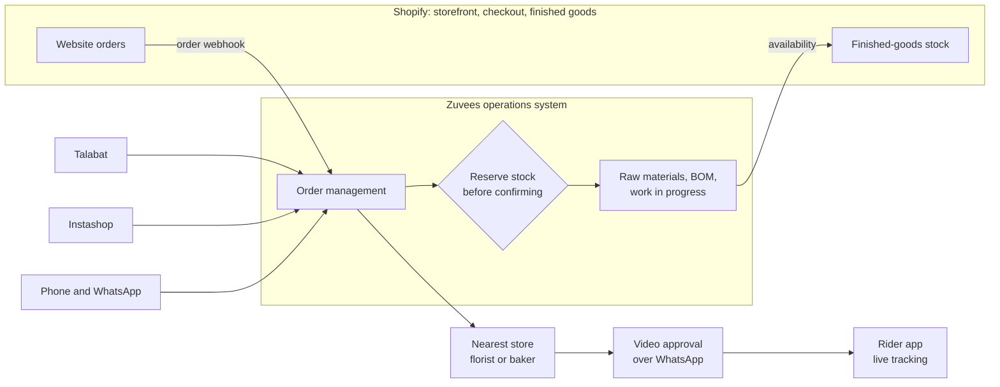
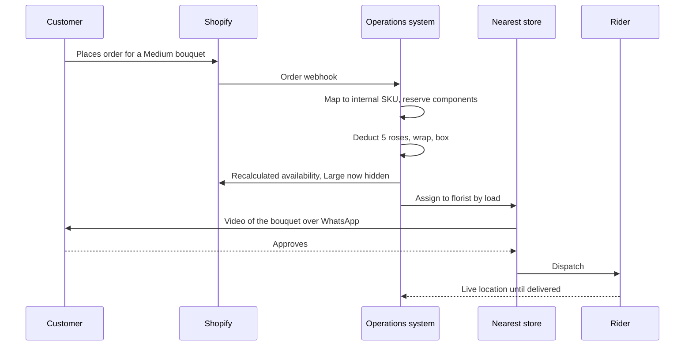
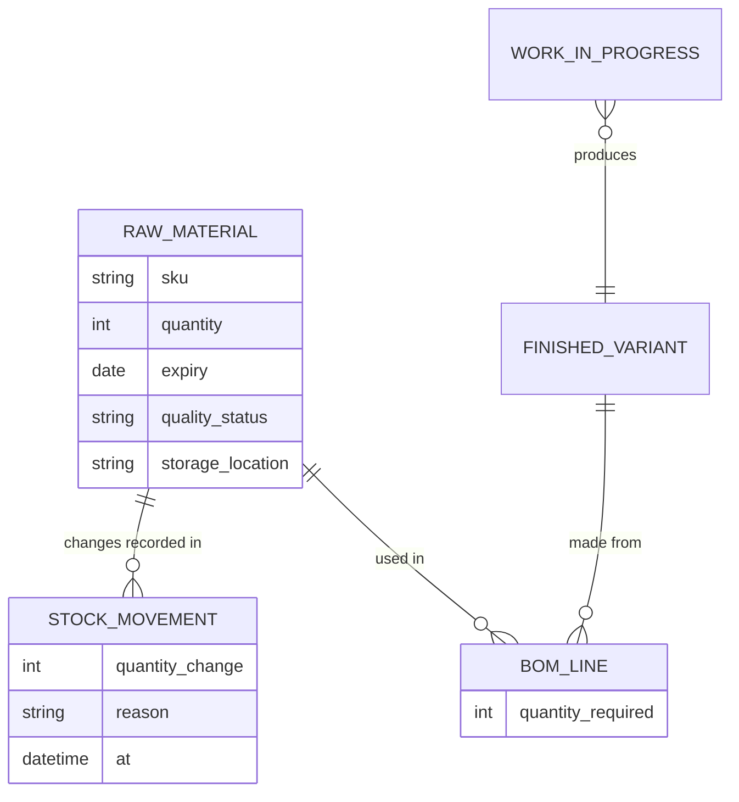
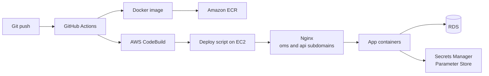

<aside class="callout">
  <strong>At a glance</strong>
  <p><b>Client:</b> Zuvees, a flowers and gifting brand in the UAE. <b>What we built:</b> the storefront on Shopify, a custom Shopify app, an order management system, inventory tracking from raw material to finished bouquet, video approval, a rider app and the DevOps behind them. <b>Duration:</b> January to mid-2025. <b>Team:</b> three engineers, a technical lead and two project leads. <b>Outcome:</b> five sales channels selling from one inventory, supporting a 60-minute delivery promise.</p>
</aside>

## Summary

Zuvees promises to deliver flowers and gifts in Dubai within 60 minutes. Behind that promise is a hard inventory problem. A bouquet is not a box on a shelf. A florist makes it to order from stems, wrapping, ribbon and a box, and the same stock is sold at once on the website, two marketplaces, the phone and WhatsApp.

The store ran on Shopify, which tracks finished products well but has no idea what a bouquet is made of. We kept Shopify for what it does best, the storefront, checkout and payments, and built an operations system around it that tracks raw materials, calculates what can actually be made, reserves stock before confirming an order, and runs fulfilment, quality approval and delivery.

This document tells that story in order: the business problem, the decision to keep Shopify, how the two systems work together, how the architecture changed as the business grew, and what we learned.

## The business

Zuvees is building a quick-commerce company for gifting in the Middle East, starting with the UAE. It sells flowers, cakes and chocolates, priced between the mass-market and luxury players, and positions itself as approachable luxury.

Customers have two ways to buy:

- **Gift now.** Choose from an express catalogue and receive it within 60 minutes.
- **Book a slot.** Choose a delivery slot up to 30 days ahead.

Orders arrive through five channels: the website on desktop and mobile, Talabat, Instashop, phone calls and WhatsApp. Phone and WhatsApp orders are entered by the customer support team.

The operation runs on a hub and store model. Stores fulfil all 60-minute orders. Slotted orders can be fulfilled by a hub or a store. Each order goes to the store nearest the customer and is assigned to an ops executive, a florist or a baker depending on the order type, who is logged in and how busy the pipeline is.

## The problem, in plain language

In ordinary ecommerce, the product you sell is the product you store. If the warehouse has ten phones, the website can sell ten phones.

Gifting does not work like that. Products are made, not picked. When a customer orders a bouquet, a florist assembles it from components. The bouquets visible on the website are really a function of the raw materials sitting in the store.

That creates three everyday failures:

1. **Selling what cannot be made.** The website thinks a bouquet is in stock, but the store has run out of the roses it needs.
2. **Selling the same thing twice.** A customer on Talabat and a customer on the website buy the last arrangement within seconds of each other.
3. **Showing what has already sold.** A product sells out on one channel but stays visible on another until someone updates it by hand.

Each one ends the same way: a disappointed customer, a refund, or a scramble to substitute, all inside a 60-minute window.

### A simple example

Imagine one bouquet with three sizes, and the store has five pink roses.

| Size | Roses needed | Can it be sold? |
| --- | --- | --- |
| Standard | 2 | Yes |
| Medium | 5 | Yes |
| Large | 10 | No, so the Large option must disappear from the store |

Shopify cannot work this out on its own. It only knows how many finished "Large bouquets" it has been told about. Someone has to calculate availability from the roses, for every size of every bouquet, every time stock changes, and push the answer to every channel. That calculation is the heart of this project.

## Keep Shopify, or rebuild?

When we started in January 2025, the first version of the website had just launched on Shopify, built by another agency. The first decision was whether the next version should stay on Shopify or be rebuilt from scratch.

| Option | Estimate | What it meant |
| --- | --- | --- |
| Rebuild from scratch | About 8 weeks | Full control, but rebuilding checkout, payments, a theme editor and everything Shopify already does well |
| Stay on Shopify | 4 to 6 weeks | A proven checkout and payments, and a theme editor the Zuvees team already used, but Shopify's inventory model to work around |

Before committing, we mapped exactly what Shopify could and could not do for a made-to-order business.

**What Shopify does well:** inventory per product and variant, multiple locations such as hubs and stores, transfers between locations, low-stock alerts, an inventory API, and stock that adjusts across sales channels.

**What Shopify cannot do for gifting:**

- Track raw materials like stems or ribbon that are not sold on their own.
- Link a finished bouquet to its components through a bill of materials.
- Represent work in progress, items being assembled or waiting for a quality check.
- Calculate made-to-order stock from raw materials.
- Track expiry dates or first-in, first-out use for perishables.
- Record quality checks, rejections or wastage.
- Run a dispatch workflow after an order is placed.

There was a technical constraint too. Shopify's storefront templates are written in Liquid, which renders pages on the server and cannot call outside systems or calculate availability on the fly. The storefront's browser-side code cannot change inventory either. Real availability logic had to live somewhere else.

**The decision:** keep Shopify as the storefront, the checkout and the record of finished goods, and build everything Shopify cannot model as a separate operations system connected through Shopify's APIs and webhooks. This approach is often called composable commerce: use a platform for the parts it is good at and compose your own services around it.

## What we built

### Phase 1: a custom Shopify app and an inventory backend (January to February 2025)

**A custom Shopify app.** Built with Remix and Prisma, it gave the Zuvees team an admin for creating product bundles and variants, marking products as add-ons, linking specific add-ons to products, managing tags and metafields, and importing and exporting in bulk. Variants cover colour, size, box type and box colour.

**An inventory backend.** A Node.js, Express and PostgreSQL service held the inventory Shopify could not see, with dashboards for three stages:

- **Raw materials:** record name, SKU, quantity and expiry date, with low-stock alerts.
- **Work in progress:** move items through production stages and record the raw materials they consume.
- **Finished goods:** keep finished-goods stock in sync between the backend and Shopify, through Shopify's inventory API.

**The emirate-based catalogue.** Customers choose their emirate first, and the catalogue and cart follow that choice, so a customer in Abu Dhabi only sees what a store near them can deliver.

**Search landing pages generated on the fly.** Product listing pages for gifting search terms are generated through a Shopify app proxy and fed to search engines, so new landing pages exist without anyone building them by hand.

### Phase 2: the order management system becomes the centre (February to June 2025)

As the operation grew, an admin inside Shopify was no longer enough. We built a standalone order management system (OMS) with Next.js, migrated the bundles app into it, and moved the catalogue towards it.

The OMS includes:

- Roles and permissions, with Google sign-in.
- A catalogue with search, filters, pagination, bulk upload, import and export, and bulk delete.
- Products with bulk tagging and collections.
- Orders from Shopify synced over webhooks, and manual order entry for Talabat and Instashop.
- Catalogue export to both marketplaces.
- Approval and notification workflows, audit logs and dashboards.
- A small monitor that checks whether the Zuvees store on Talabat is open or closed.

### Raw materials moved in-house

We started integrating Pyrops, an external warehouse management system, for warehouse operations such as raw-material masters and inward stock. In May 2025 that integration was dropped. Raw material, work-in-progress and finished-goods movement and reconciliation were built into the OMS instead, so inventory stayed in one system the team controlled.

### The storefront

Built on Shopify with a custom theme: emirate selection, predictive search, filters and facets, colour variants, add-ons and gift card messages, a wishlist, delivery date and slot selection, customer profiles and order history, and delivery fee calculation. Custom Shopify apps handle bundles, add-ons, social login and webhooks. An AI Gift Advisor helps customers who know the occasion but not the product.

### Quality and delivery

- **Video approval.** At the cart, a customer can choose to approve the arrangement before it leaves. Staff record a video of the finished bouquet and the customer approves it over WhatsApp. It keeps luxury-grade quality inside a 60-minute window.
- **Rider app.** A React Native app with maps and background location tracking, so the team can see where every delivery is.
- **External riders.** Riders who are not on the app get WhatsApp links instead.


## How it works

### Two layers, each doing what it is good at



Shopify owns the shopping experience and the finished-goods stock that customers see. The operations system owns everything behind it: what each product is made of, how much of each component is left, which store handles the order, and where it is on its way to the customer.

### The life of an order



The steps that matter most happen before the order is confirmed. Every product, from every channel, is mapped to one internal SKU model, because Talabat, Instashop and the website all name the same bouquet differently. The system reserves the components the order needs, deducts them, recalculates what can still be made and pushes the new availability to Shopify. The storefront then stops offering any size the store can no longer make.

### The data model

The inventory model was designed around how a bouquet is actually made.



- **Raw materials** carry SKU, quantity, expiry date, quality status and storage location.
- **Stock movements** form a ledger. Every change to a raw material is recorded with a reason, so stock can always be explained.
- **Bill of materials lines** link each finished variant to the raw materials it needs and in what quantity.
- **Work in progress** records items being assembled and the raw materials they consumed.

<details>
  <summary>For engineers: calculating availability</summary>

Shopify's templates cannot compute this, so the operations system does it and writes the result back to Shopify. In simplified form, a variant can be made as many times as its scarcest component allows. This is an illustration, not production code.

```ts
function buildableUnits(variantId: string): number {
  const lines = bom.linesFor(variantId); // e.g. [{ sku: "rose-pink", qty: 10 }, { sku: "box-large", qty: 1 }]
  return Math.min(
    ...lines.map(line => Math.floor(stock.available(line.sku) / line.qty))
  );
}

// 5 pink roses in stock:
// Standard needs 2 -> 2 units, Medium needs 5 -> 1 unit, Large needs 10 -> 0 units, so Large is hidden
```

Whenever stock changes, the affected variants are recalculated and their availability is pushed to Shopify through its inventory API. The storefront reads those values, so a size that cannot be made never reaches the cart. Shopify's admin API is rate-limited, so updates are batched and cached rather than sent one by one.
</details>

### How it ships



The OMS and the API run in Docker containers on AWS EC2 behind Nginx, each on its own subdomain, with RDS for the database and credentials in AWS Secrets Manager and Parameter Store. A push to GitHub triggers GitHub Actions, which builds the image and pushes it to Amazon ECR. AWS CodeBuild then runs the deployment on EC2, which pulls the new image and restarts the container. Containers restart automatically if they crash, health checks and CloudWatch alarms watch the services, and staging environments for the OMS and the website keep testing away from live orders.

## What made it hard

| Challenge | Why it mattered | How we handled it |
| --- | --- | --- |
| Inventory Shopify cannot see | Every bouquet consumes components that run out on their own schedule | Availability calculated from raw materials outside Shopify, then written back |
| Race conditions | Two channels could sell the last unit at the same moment | Stock reserved centrally before an order is confirmed |
| Overselling from slow sync | A sold-out product stayed visible on another channel | Availability recalculated on every stock change and pushed to every channel |
| SKU mismatch | The same bouquet had different names and variants on each channel | One internal SKU model that every channel maps to |
| Unreliable marketplace events | Order events could arrive late, twice or out of order | Events reconciled into one order record, with audit logs |
| Moving the boundary while live | The admin moved from a Shopify app into a standalone OMS, and warehouse tracking moved in-house | Phased migration while the store kept trading |
| SLA pressure | Stock check, preparation, approval and dispatch all fit inside 60 minutes | Nearest-store routing, load-based assignment and live rider tracking |

## Timeline

| When | Milestone |
| --- | --- |
| December 2024 | First version of the website launches on Shopify, built by another agency |
| January 2025 | Decision to stay on Shopify. Custom Shopify app, inventory backend and theme work begin |
| February 2025 | Emirate-based catalogue, search landing pages, OMS schema and order sync |
| March 2025 | Bundles app migrated into the OMS. Catalogue, roles, Google sign-in, Shopify order view and manual marketplace order entry live |
| 8 April 2025 | New storefront goes live |
| April to June 2025 | OMS releases, rider tracking, WhatsApp rider links, video approval, raw-material tracking moved in-house, DevOps and staging |

## Results

- The **60-minute promise is supported end to end**, from order to rider.
- **Five sales channels sell from one shared inventory**, with availability calculated from raw materials.
- The **storefront went live on 8 April 2025**, followed by the order management system, the rider app and DevOps through mid-2025.
- Zuvees **kept Shopify's checkout, payments and theme editor** and gained the inventory, fulfilment and approval workflows Shopify could not provide.
- The **operations system belongs to Zuvees**, so the business can change how it works without waiting for a platform to support it.

## Lessons for engineering teams

- **Map the platform's limits before you decide.** A one-page list of what Shopify could not do made the build-or-keep decision clear.
- **Use the platform for what it is good at.** Checkout and payments are solved problems. The made-to-order inventory was not.
- **Model the business, not the screen.** Gifting is manufacturing. Once the data model reflected raw materials, bills of materials and work in progress, the features followed.
- **Expect the boundary to move.** The admin started inside Shopify and moved out as the business grew. Designing for that move made it cheap.
- **One SKU language for every channel.** Translating every marketplace into one internal model is what made a single inventory possible.

<details>
  <summary>Glossary for non-engineers</summary>

- **Quick commerce:** delivery within minutes or a couple of hours rather than days.
- **SKU:** stock keeping unit, the code that identifies one specific product variant.
- **Bill of materials (BOM):** the list of components and quantities needed to make one finished product.
- **Work in progress (WIP):** items that are being made but are not yet ready to sell.
- **Composable commerce:** using an ecommerce platform for some jobs and your own services for others, connected through APIs.
- **Webhook:** a message one system sends another when something happens, such as "new order".
- **Order management system (OMS):** the internal tool that tracks an order from placement to delivery.
- **App proxy:** a Shopify feature that lets a store page be generated by an outside service.
</details>

## Stack

Shopify, Liquid, Shopify app proxy, Remix, Prisma, Next.js, Node.js, Express, PostgreSQL, React Native, Docker, Nginx, AWS (EC2, ECR, CodeBuild, RDS, Secrets Manager, Parameter Store, CloudWatch), GitHub Actions.
