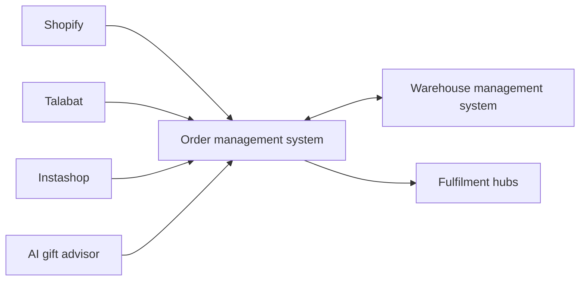

## Sixty-minute delivery leaves little room for disconnected systems

Zuvees delivers gifts in Dubai with a promise measured in minutes, not days. Fulfilling that promise depends on much more than a fast courier.

An order may begin on Shopify, Talabat or Instashop. Inventory may be distributed across fulfilment hubs and managed through a warehouse system. If those systems disagree about what is available or where an order should go, a customer-facing promise can quickly become an operational problem.

Zuvees needed a reliable centre for that moving network.

## Building the operational layer between every channel

NST Studio built a custom order management system that connects the storefront, marketplaces, warehouse tooling and fulfilment hubs.

Instead of asking the operations team to reconcile each channel manually, the platform gives orders and inventory a shared path through the business.

Each integration has a different role, but the order management system holds the workflow together.

| Connected system | Role in the experience |
| --- | --- |
| Shopify | Direct storefront orders |
| Talabat | Marketplace orders |
| Instashop | Marketplace orders |
| Warehouse management system | Inventory and warehouse operations |
| Fulfilment hubs | Local order preparation and dispatch |

## One order, wherever it begins

Customers do not think in terms of sales channels. They expect the same availability and delivery experience wherever they place an order.

The custom OMS creates that continuity. It receives orders from different sources, coordinates with warehouse operations and routes the work towards fulfilment. The operational team gets one system around which the fulfilment process can be organised.

## Product discovery was part of the same journey

Choosing a gift is a different problem from delivering one. Customers may know the occasion and the recipient, but not the right product.

The platform therefore also includes an AI gift advisor. It helps turn a broad intent into product discovery, while the connected commerce system handles the operational path that follows.

This keeps the customer journey—from deciding what to buy to getting it delivered—inside one product experience.

## What changed

Zuvees gained a common operational layer across its storefront, marketplaces, warehouse tooling and fulfilment network.

The main result is alignment: orders can enter through different channels without requiring an entirely separate operational process for each one, while inventory and fulfilment remain connected to the same system.

<aside class="callout">
  <strong>The outcome</strong>
  
One order-management workflow now connects product discovery, inventory, marketplace orders and fulfilment across multiple hubs.

</aside>

<!-- Editorial follow-up: confirm order volume, sync frequency, delivery performance, operational time saved and approved product screenshots. -->
