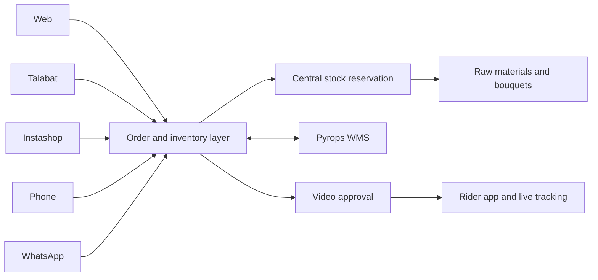

## The challenge

Zuvees sells made-to-order bouquets in Dubai through its website, Talabat, Instashop, phone and WhatsApp. Every bouquet consumes loose stock across several raw materials. Orders from all five channels can arrive at the same time, while the customer expects delivery within 60 minutes.

Slow inventory sync caused stock mismatches and overselling. Marketplace events could arrive late, appear more than once or arrive out of order. Product identifiers also differed across channels.

## What we built

NewtonSchool Studio built one order and inventory layer across all five channels. The system reserves stock centrally before confirming an order and tracks raw materials from individual components to finished bouquets.

The wider product includes:

- video approval before dispatch
- a React Native rider app with live tracking and WhatsApp rider links
- slot-based pricing and NPS
- a Shopify storefront with an emirate-based catalogue and delivery slots
- custom Shopify apps for bundles and add-ons
- SEO pages and an AI Gift Advisor
- reliable reconciliation for marketplace order events
- audit logs, staging and test environments, and CI/CD on AWS

Pyrops WMS stays in sync with the shared operational layer. A pod of three engineers, a technical lead and two project leads delivered the work.

## How it works

Every channel's products are normalised into one internal SKU model. An order reaches the central layer, which reserves the required finished product and raw materials before confirmation. That reservation prevents two concurrent orders from consuming the same final item.

Marketplace events pass through reconciliation that handles delayed, duplicated and out-of-order messages. Audit logs make each processing decision traceable.

## What made it hard

- Two channels could try to sell the last unit at the same moment.
- Slow sync could expose stock that was already committed.
- The same product used different SKUs across channels.
- Each bouquet consumed several raw-material components.
- Marketplace webhooks were unreliable.
- Stock, preparation, approval and dispatch had to fit inside 60 minutes.

## Results

The platform supports a 60-minute delivery promise across five sales channels using one shared inventory. The storefront went live in April 2025, followed by order management, the rider app and DevOps.

**Stack:** Shopify, Liquid, Remix, GraphQL, Node.js, Express, Prisma, Next.js, React Native, Docker, AWS EC2, Nginx and GitHub Actions.
